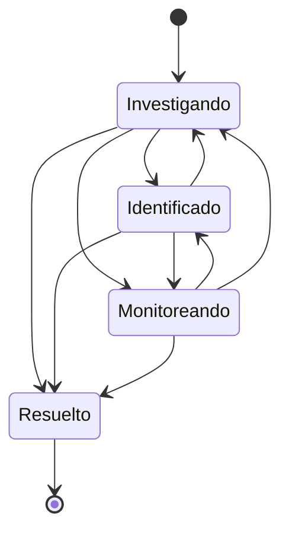

# Contenidos para clientes

**Estado:** v0, construido el 2026-11-01 · **Parte de:** [diseño del núcleo](README.md) · **Guía de uso:** [docs/contenidos](../docs/contenidos/README.md)

Este documento define lo que un proveedor publica para sus clientes además de las facturas: la base de conocimiento,
los anuncios, las descargas y el estado de la red. Es diseño propio. De los datos del sistema anterior se toma solo la
estructura de las tablas, para la importación (sección 11). Ningún nombre, texto ni estructura sigue a los
de otro sistema.

---

## 1. Resumen

| Pieza | Qué resuelve | Dónde vive |
|---|---|---|
| Base de conocimiento | Categorías anidadas, artículos con una versión por idioma, búsqueda, votos de utilidad y sugerencias al abrir un ticket | `content.categories`, `content.articles`, `content.article_texts`, `content.article_votes` |
| Anuncios | Borrador, publicación programada, fijados, vencimiento y RSS | `content.announcements` |
| Descargas | Archivos por categoría, para todos los clientes o solo para quienes tienen un producto o están en un grupo, con contador, tope de tamaño y tipos permitidos | `content.downloads`, `content.download_files` |
| Estado de la red | Servidores y servicios con su estado, incidentes y mantenimientos con su historial, y suscripción por correo | `content.components`, `content.status_events`, `content.status_event_components`, `content.status_event_updates`, `content.subscribers` |

Lo que este módulo no hace:
- Los tickets son de Soporte. Contenidos le ofrece el caso de uso de sugerencias (sección 3.5) y Soporte lo llama al abrir
  un ticket.
- Los grupos de clientes los define el diseño de cuentas avanzadas (`accounts.groups` y `accounts.accounts.group_id`). Esta
  rama trae solo el mínimo para compilar y probar (el ID y el nombre del grupo, y la columna de la cuenta) con los mismos
  nombres. Al integrar vale la definición completa de esa rama.

---

## 2. Reglas comunes

### 2.1 Textos por idioma

Cada contenido guarda sus textos en `es-AR` y en `en`. `es-AR` es el idioma de base. Un texto tiene título, resumen y
cuerpo, y cada pieza usa los que necesita (una categoría usa título y resumen como nombre y descripción, un componente de
red igual). Quien lee ve su idioma. Si ese idioma no existe para el contenido, ve el de base, y si tampoco existe, el
primero que haya. La pantalla avisa cuando muestra otro idioma.

Los textos van en una columna `texts` en `jsonb`, una entrada por idioma. La excepción son los artículos: sus textos
están en `content.article_texts`, una fila por idioma, porque la búsqueda necesita un índice por cada uno.

### 2.2 Audiencia

Los artículos, los anuncios y las descargas dicen quién los ve:

| Audiencia | Quién |
|---|---|
| `Public` | Cualquiera, sin iniciar sesión |
| `Customers` | Cualquier cliente con sesión |
| `Targeted` | Clientes con sesión que cumplen alguna de las dos condiciones, y al menos una lista tiene que tener datos |

Las condiciones de `Targeted` son tener un servicio vivo (no terminado ni cancelado) de alguno de los productos de la
lista, o que una de las cuentas que el usuario puede ver esté en alguno de los grupos de la lista. Una sesión puede
operar varias cuentas: cuenta la unión de todas.

Quien no cumple la audiencia recibe 404, igual que si el contenido no existiera (sección 13 del
[modelo de dominio](dominio.md)). La regla vive en un solo lugar (`ContentViewer`) y la usan las páginas, la API y la
búsqueda. Una categoría se muestra si tiene algún contenido visible para quien mira, ella o sus subcategorías.

### 2.3 Estados de publicación

Los artículos, los anuncios y las descargas comparten tres estados:

| Estado | Qué quiere decir |
|---|---|
| `Draft` | Borrador. Solo lo ve el staff |
| `Published` | Publicado. Lo ve quien cumple la audiencia, con las condiciones propias de cada pieza |
| `Archived` | Retirado sin borrarlo. Solo lo ve el staff y se puede volver a publicar |

Las transiciones son libres entre los tres, con dos reglas de cada pieza: una descarga no se publica sin archivo y un
artículo no se publica sin al menos un texto con título y cuerpo.

### 2.4 Markdown seguro

Los cuerpos se escriben en un Markdown acotado y se convierten a HTML al mostrarlos. Nunca se guarda ni se acepta HTML.
Lo que el Markdown no entiende queda como texto, con los caracteres especiales codificados.

| Se acepta | Notas |
|---|---|
| Títulos `#` a `####`, párrafos, saltos de línea | El `#` sale como `h2`: el `h1` es el título de la página |
| Negrita, cursiva, código en línea y bloques de código | Los bloques son con tres comillas invertidas |
| Listas con viñetas y numeradas, con anidado | |
| Citas, regla horizontal y tablas con barras | |
| Enlaces e imágenes | Con las reglas de abajo |

Reglas de las direcciones:
- Un enlace puede ser `http`, `https`, `mailto`, `tel`, una ruta del propio sitio que empiece con una barra o un ancla.
  Cualquier otra cosa (`javascript:`, `data:`, `//otro.sitio`) queda como el texto del enlace, sin dirección.
- Un enlace a otro sitio sale con `rel="noopener noreferrer"`.
- Una imagen puede ser del propio sitio o de un host de la lista `Content:ImageHosts`, siempre por `https`. Cualquier otra
  muestra su texto alternativo. La política de seguridad del navegador de la interfaz ya limita las imágenes al propio
  sitio, y las páginas de contenidos le suman solo los hosts configurados.
- Un cuerpo no pasa de 200.000 caracteres.

La conversión es lineal: una entrada armada para trabar el conversor no lo frena (la anidación tiene tope y las
búsquedas de cierre no se repiten).

### 2.5 Varios nodos, concurrencia y auditoría

- Nada que importe vive en memoria de un nodo. Los contadores (lecturas, votos, descargas) suben con `UPDATE ... SET
  n = n + 1`, así que dos nodos a la vez no pierden una cuenta.
- Cada contenido editable lleva un número de revisión que sube con cada cambio. Guardar con un número atrasado falla con
  409 y dice que otra persona lo modificó. La API acepta `revision` opcional, y las pantallas lo mandan siempre.
- Las tareas diferidas (avisos de la red) salen por la cola de trabajos con su clave de entidad (sección 10).
- Las acciones del staff quedan en la auditoría (`platform.audit_events`) con la acción, el ID y los datos chicos del
  cambio, nunca el texto completo: `content.article.create`, `content.article.publish`, `content.announcement.archive`,
  `content.download.upload`, `status.incident.open`, `status.maintenance.cancel` y las demás con el mismo formato.

### 2.6 Identificadores y direcciones

Los IDs son enteros de 64 bits. Los artículos, las categorías, los anuncios, las descargas y los eventos de la red
importados conservan el ID del origen (D-17). Las categorías de la base de conocimiento y las de las descargas comparten tabla
y numeración, y los dos orígenes numeran por su cuenta: una categoría de descargas conserva su ID si está libre y si no toma
uno nuevo, por encima de todos los del origen. Los artículos y las categorías tienen además un `slug` único, que se arma con el título en el idioma
de base: sin tildes, en minúscula y con guiones. Un `slug` solo de dígitos se prefija con `n-` para no confundirse con un ID.

Las páginas aceptan el ID donde esperan un `slug` (`/conocimiento/{id}` y `/conocimiento/c/{id}`) y redirigen para siempre a la
dirección corta. Con eso las direcciones que el proveedor ya difundió en su sitio y en sus correos siguen andando: `LegacyUrls`
responde un 301 sin consultar la base para la base de conocimiento, los anuncios, las descargas, el estado de la red y el
formulario de tickets. Un número solo es un artículo y un número con un nombre atrás es una categoría, que es como las armaba el
sistema anterior. Las rutas se tomaron de los enlaces de un sitio de proveedor real y están en la guía de uso.

---

## 3. Base de conocimiento

### 3.1 Modelo

| Concepto | Qué es | Invariantes |
|---|---|---|
| Categoría (`ContentCategory`, tipo `KnowledgeBase`) | Agrupa artículos. Puede tener una categoría madre, hasta tres niveles | El `slug` es único por tipo. La madre es del mismo tipo (clave foránea compuesta). Una categoría no es su propia ancestra. No se borra si tiene artículos o subcategorías |
| Artículo (`Article`) | Pertenece a una categoría. Tiene audiencia, estado, destacado y orden | El `slug` es único. Una audiencia `Targeted` tiene productos o grupos. Los contadores nunca son negativos |
| Texto de artículo (`ArticleText`) | Título, resumen, cuerpo y etiquetas en un idioma | Uno por artículo e idioma. El título es obligatorio |
| Voto (`ArticleVote`) | Si el artículo le sirvió a quien lo votó | Uno por artículo y votante. Cambiar el voto lo reemplaza |

El votante es el usuario del portal si tiene sesión, y si no una cookie propia que se crea al votar. Los contadores del
artículo (`helpful`, `unhelpful`) se mueven en la misma transacción que el voto. Las lecturas (`views`) suben con cada
pedido del artículo publicado.

### 3.2 Búsqueda

Búsqueda de texto completo de PostgreSQL, sin extensiones. Cada texto tiene una columna `search` generada, con el título
con peso A, el resumen y las etiquetas con peso B y el cuerpo con peso C, y un índice GIN. La configuración del idioma
(`spanish` o `english`) sale del idioma de la fila. Las tildes se pliegan con `translate` tanto al indexar como al
consultar, así "configuracion" encuentra "configuración".

- La consulta de una persona usa la sintaxis de búsqueda web (frases entre comillas, `-` para excluir, `or`).
- Se busca en el idioma del lector y en el de base, y cada artículo cuenta una vez con su mejor puntaje. Se muestra en el
  idioma del lector si existe.
- Solo cuentan los artículos publicados y visibles para quien busca.

### 3.3 Lo que ve el cliente

| Ruta | Qué muestra |
|---|---|
| `/conocimiento` | Buscador, categorías con la cantidad de artículos, destacados y últimos |
| `/conocimiento?q=` | Resultados de la búsqueda, ordenados por relevancia |
| `/conocimiento/c/{slug}` | Una categoría con sus subcategorías y artículos, y las migas de pan |
| `/conocimiento/{slug}` | El artículo, con el voto de utilidad y otros artículos de la categoría |
| `/conocimiento/{id}` | Redirección permanente al `slug`, para los enlaces que conservan el ID de origen |

### 3.4 Votos y lecturas

El voto se manda por un formulario (con htmx se reemplaza solo el bloque del voto) y tiene el tope por IP de los
formularios públicos. Un voto repetido del mismo votante cambia el anterior. Leer el artículo suma una lectura aunque no
haya sesión.

### 3.5 Sugerencias al abrir un ticket

`KnowledgeService.Suggest(viewer, text, language, limit)` recibe el asunto y el texto del ticket y devuelve hasta cinco
artículos publicados y visibles para esa cuenta. Soporte lo llama desde el formulario de ticket y la API lo ofrece en
`GET /api/v1/kb/suggestions`.

La consulta arma una búsqueda con "o" entre las palabras con contenido (hasta doce, las más largas primero, sin
palabras vacías del idioma), y ordena por relevancia. No hace falta que aparezcan todas. Un texto sin palabras útiles
devuelve una lista vacía.

---

## 4. Anuncios

### 4.1 Modelo

| Concepto | Qué es | Invariantes |
|---|---|---|
| Anuncio (`Announcement`) | Texto con título y cuerpo en cada idioma, audiencia, estado, fijada y fechas | `expires_at` es posterior a `publish_at`. Una audiencia `Targeted` tiene productos o grupos |

### 4.2 Estado que ve el staff

El estado guardado es `Draft`, `Published` o `Archived`. La fase se deduce con la hora, nunca con un trabajo que cambie
filas:

| Fase | Condición |
|---|---|
| Borrador | `Draft` |
| Programada | `Published` con `publish_at` en el futuro |
| Publicada | `Published` con `publish_at` pasado y sin vencer |
| Vencida | `Published` con `expires_at` pasado |
| Archivada | `Archived` |

Publicar sin fecha usa el momento actual. Una fecha futura la deja programada, y a esa hora empieza a verse en todos los
nodos sin que nadie la toque. Despublicar la vuelve a borrador y archivar la retira.

### 4.3 Lo que ve el cliente

| Ruta | Qué muestra |
|---|---|
| `/anuncios` | Los publicados vigentes para quien mira, con los fijados arriba y después los más nuevos |
| `/anuncios/{id}` | Un anuncio completo |
| `/anuncios.rss` | Canal RSS 2.0 con los públicos vigentes, en `es-AR` o en `en` con `?lang=en` |

El canal es anónimo, así que solo lleva anuncios de audiencia `Public`. Sus enlaces usan `Billing:PublicUrl`, el cuerpo
va ya convertido a HTML dentro de `description` y lleva `lastBuildDate`, `pubDate` y un `guid` estable por anuncio.

---

## 5. Descargas

### 5.1 Modelo

| Concepto | Qué es | Invariantes |
|---|---|---|
| Categoría (`ContentCategory`, tipo `Downloads`) | Agrupa descargas, con las mismas reglas que las de la base de conocimiento | |
| Descarga (`Download`) | Título y descripción por idioma, audiencia, estado, orden, contador y los datos del archivo: nombre, tipo, tamaño y SHA-256 | No se publica sin archivo. Una audiencia `Targeted` tiene productos o grupos |
| Archivo (`DownloadFile`) | Los bytes, en una tabla aparte para que ninguna lista los lea | Uno por descarga. Se borra con ella |

### 5.2 Archivos

Los bytes se guardan en PostgreSQL detrás de la interfaz `IContentFileStore` (D-14). La receta con varios nodos los
replica con la base, y un almacenamiento compatible con S3 entra implementando la misma interfaz. Reglas:

- **Tope de tamaño:** `Content:MaxDownloadBytes`, 50 MiB por defecto. Pasarlo da 413 y no deja nada a medias.
- **Tipos permitidos:** por extensión, con la lista de `Content:AllowedDownloadExtensions` (archivos comprimidos,
  instaladores, imágenes de disco, documentos y texto). Los tipos que un navegador ejecuta o interpreta (`html`, `svg`,
  `js`) no están. Otra extensión da 415.
- **Nombre:** se limpia a letras, números, punto, guion y guion bajo. Sin rutas.
- **Contenido:** se calcula el SHA-256 al subir y la página lo muestra para que el cliente pueda verificar la descarga.
- **Salida:** siempre como adjunto (`Content-Disposition: attachment`), con el tipo fijo que corresponde a la extensión,
  `X-Content-Type-Options: nosniff` y sin caché compartida.

Subir un archivo a una descarga que ya tiene uno lo reemplaza, y la descarga sigue en el estado en que estaba. Reemplazar
no reinicia el contador.

### 5.3 Audiencia y contador

El listado muestra solo lo que quien mira puede bajar, y el endpoint del archivo vuelve a comprobarlo: un archivo que no
corresponde da 404. Cada pedido completo del archivo suma uno al contador, con un `UPDATE` atómico.

### 5.4 Lo que ve el cliente

| Ruta | Qué muestra |
|---|---|
| `/descargas` | Las descargas visibles agrupadas por categoría, con tamaño, fecha, SHA-256 y cantidad de descargas |
| `/descargas/{id}/archivo` | El archivo, si corresponde |

---

## 6. Estado de la red

### 6.1 Modelo

| Concepto | Qué es | Invariantes |
|---|---|---|
| Componente (`StatusComponent`) | Lo que tiene estado: un servidor, un servicio o un grupo que junta a otros. Con orden, oculto, y los productos que afecta | Un grupo no tiene madre y sus hijos no son grupos. Un componente con historial no se borra: se oculta |
| Evento (`StatusEvent`) | Un incidente o un mantenimiento programado, con título por idioma, estado, desde y hasta | Un mantenimiento tiene desde y hasta, con hasta posterior a desde. Un incidente solo tiene hasta cuando está resuelto |
| Componente de un evento (`StatusEventComponent`) | Qué componentes toca y con qué impacto | El impacto de un incidente es degradado, interrupción parcial o interrupción total, y el de un mantenimiento es mantenimiento |
| Novedad de un evento (`StatusUpdate`) | Cada mensaje que se publica sobre el evento, con el estado en que lo deja | Solo se agregan. Quedan como el historial del evento |
| Suscriptor (`StatusSubscriber`) | Una casilla que recibe los avisos, de todos los componentes o de los que eligió | Una casilla por suscriptor sin distinguir mayúsculas. No recibe nada hasta confirmarla |

### 6.2 Estado de un componente

El estado de un componente no se guarda: se calcula con los eventos vigentes, así nunca queda desfasado. Del más leve al
más grave:

| Estado | Cuándo | Punto y forma |
|---|---|---|
| Operativo | Ningún evento vigente lo toca | Verde, lleno |
| Mantenimiento | Hay un mantenimiento en curso | Azul, hueco |
| Degradado | Un incidente abierto lo marca degradado | Ámbar, hueco |
| Interrupción parcial | Un incidente abierto lo marca con interrupción parcial | Ámbar, con anillo |
| Interrupción total | Un incidente abierto lo marca con interrupción total | Rojo, con anillo |

Con varios eventos vigentes, gana el más grave. Un grupo toma el más grave de sus hijos visibles. El estado global del
sitio es el más grave de todos los componentes visibles. El estado se muestra siempre con el punto, la palabra y la forma
(sección 4.4 del diseño de la interfaz), nunca solo con el color.

### 6.3 Incidentes

Abrir un incidente pide un título, al menos un componente con su impacto y un primer mensaje. Un mantenimiento también pide al
menos un componente. Cada novedad que se publica puede
cambiar el estado, y puede cambiar también el impacto de los componentes. Al pasar a resuelto se fija el `hasta` con la
hora de esa novedad y el incidente deja de afectar a los componentes. Un incidente resuelto no se reabre: si vuelve a
pasar, se abre otro.

### 6.4 Mantenimientos

El estado guardado es `Scheduled`, `Completed` o `Cancelled`. La fase que ve el público se deduce con la hora:

| Fase | Condición |
|---|---|
| Próximo | `Scheduled` y todavía no empezó |
| En curso | `Scheduled` y la hora está entre el desde y el hasta. Los componentes figuran en mantenimiento |
| Terminado | `Completed`, o `Scheduled` con el hasta pasado |
| Cancelado | `Cancelled` |

El staff puede reprogramar un mantenimiento próximo o en curso, cancelarlo y darlo por terminado antes de hora. Cada cambio
se puede acompañar con una novedad.

### 6.5 Suscripción por correo

1. Quien quiere los avisos escribe su casilla en `/estado-red/suscribirse`, con su idioma y, si quiere, los componentes.
2. El sistema guarda la suscripción sin confirmar y manda un correo con un enlace de confirmación. La respuesta es la misma
   exista o no la casilla, para no revelar quién está suscripto. El correo de confirmación sale a lo sumo una vez por hora
   para la misma casilla.
3. El enlace `/estado-red/suscripcion/confirmar/{token}` la confirma. Las suscripciones sin confirmar de más de siete días se
   borran al suscribir a otra persona.
4. Cada aviso lleva `/estado-red/suscripcion/baja/{token}`. La página pide confirmación con un botón antes de borrar: un
   programa de correo que abre los enlaces no puede darla de baja.

El token es un valor aleatorio de 32 bytes, de un solo propósito (confirmar o dar de baja esa casilla). No inicia sesión ni
muestra datos.

### 6.6 Lo que ve el cliente

| Ruta | Qué muestra |
|---|---|
| `/estado-red` | Estado global, componentes agrupados, eventos vigentes, mantenimientos próximos y los últimos días, y el formulario para suscribirse |
| `/estado-red/{id}` | Un evento con todas sus novedades |
| `/estado-red/historial` | Eventos pasados por mes |
| `/estado-red/suscribirse` | Formulario de suscripción |
| `/estado-red/suscripcion/{confirmar o baja}/{token}` | Confirmar o dar de baja |

Los componentes tienen los productos que afectan, así que `StatusService.IssuesForProducts` devuelve los eventos vigentes
y próximos de esos productos. El portal los muestra en una tarjeta de incidentes y mantenimientos conocidos, en `/servicios` y
en el inicio, para los productos de los servicios vivos del cliente. El formulario de ticket es de Soporte, que los pide por
`GET /api/v1/status/issues`.

El historial por mes cuenta el mes a medianoche en la zona horaria del proveedor (`Billing:TimeZone`), no en UTC.

---

## 7. Permisos

| Permiso del staff | Qué permite |
|---|---|
| `content.read` | Ver la administración de contenidos, borradores y archivados incluidos |
| `content.write` | Crear, editar, publicar, archivar y borrar artículos, categorías, anuncios y descargas |
| `status.write` | Abrir y actualizar incidentes y mantenimientos, editar los componentes y ver y borrar suscriptores |

| Permiso de la API key | Qué permite |
|---|---|
| `kb:read`, `kb:write` | Leer y escribir la base de conocimiento. Leer incluye las sugerencias y la búsqueda |
| `announcements:read`, `announcements:write` | Anuncios |
| `downloads:read`, `downloads:write` | Descargas y sus categorías, y subir el archivo |
| `status:read`, `status:write` | Estado de la red, incidentes, mantenimientos y suscriptores |

Las páginas públicas no piden permiso: aplican la audiencia de cada contenido.

---

## 8. API

Todo cuelga de `/api/v1`, con API key, Problem Details y los tópicos de D-11. Las listas devuelven el contenido completo del
staff (con borradores) salvo `suggestions` y `search`, que muestran lo que vería el cliente. Los textos viajan como un
objeto por idioma: `"texts": { "es-AR": { "title": "...", "summary": "...", "body": "..." }, "en": { ... } }`.

| Método y ruta | Permiso | Qué hace |
|---|---|---|
| `GET /kb/categories` | `kb:read` | Todas las categorías |
| `POST /kb/categories`, `PUT /kb/categories/{id}`, `DELETE /kb/categories/{id}` | `kb:write` | Crear, cambiar y borrar. Borrar una con contenido da 409 |
| `GET /kb/articles` | `kb:read` | Lista con `category_id`, `status`, `q` y `limit` |
| `GET /kb/articles/{id}` | `kb:read` | El artículo con todos sus textos |
| `POST /kb/articles`, `PUT /kb/articles/{id}`, `DELETE /kb/articles/{id}` | `kb:write` | Crear, cambiar y borrar |
| `PUT` y `DELETE /kb/articles/{id}/texts/{language}` | `kb:write` | Cargar o sacar el texto de un idioma |
| `POST /kb/articles/{id}/publish`, `unpublish`, `archive` | `kb:write` | Cambiar el estado |
| `GET /kb/search` | `kb:read` | Búsqueda como la ve un cliente. `q`, `language`, `account_id` y `limit` |
| `GET /kb/suggestions` | `kb:read` | Sugerencias para un ticket. `q`, `language`, `account_id` y `limit` |
| `GET`, `POST`, `PUT`, `DELETE /announcements` y `/announcements/{id}` | `announcements:read` y `:write` | Anuncios. `status` filtra la lista |
| `POST /announcements/{id}/publish`, `unpublish`, `archive` | `announcements:write` | `publish` acepta `publish_at` |
| `GET`, `POST`, `PUT`, `DELETE /download-categories` | `downloads:read` y `:write` | Categorías de descargas |
| `GET`, `POST`, `PUT`, `DELETE /downloads` y `/downloads/{id}` | `downloads:read` y `:write` | Descargas |
| `PUT /downloads/{id}/file?name=` | `downloads:write` | Sube el archivo en el cuerpo del pedido. Devuelve tamaño y SHA-256 |
| `GET /downloads/{id}/file` | `downloads:read` | Baja el archivo sin sumar al contador |
| `POST /downloads/{id}/publish`, `unpublish`, `archive` | `downloads:write` | Cambiar el estado |
| `GET /status` | `status:read` | Estado global, componentes, eventos vigentes y próximos |
| `GET`, `POST`, `PUT`, `DELETE /status/components` | `status:read` y `:write` | Componentes |
| `GET /status/issues?product_id=` | `status:read` | Eventos vigentes y próximos de esos productos |
| `GET`, `POST /status/incidents`, `GET /status/incidents/{id}` | `status:read` y `:write` | Incidentes |
| `POST /status/incidents/{id}/updates` | `status:write` | Publicar una novedad |
| `GET`, `POST /status/maintenances`, `GET /status/maintenances/{id}` | `status:read` y `:write` | Mantenimientos |
| `PUT /status/maintenances/{id}`, `POST .../updates`, `.../cancel`, `.../complete` | `status:write` | Reprogramar, publicar novedad, cancelar y terminar |
| `GET /status/subscribers`, `DELETE /status/subscribers/{id}` | `status:read` y `:write` | Suscriptores, sin los tokens |

Errores: `404` si no existe, `409` si el cambio choca (revisión vieja, categoría con contenido, `slug` repetido), `413` y
`415` en la subida y `422` si los datos no valen.

---

## 9. Pantallas del panel

Las pantallas son las del menú de Soporte (Base de conocimiento, Anuncios, Descargas y Estado de la red), con las rutas de la sección 10.2 de `interfaz-y-temas.md`. `/admin/contenidos` es la portada con lo pendiente y las junta en solapas. Siguen el sistema visual y los textos de la interfaz (voseo,
botones con verbo y objeto, estado con punto, palabra y forma). Los editores guardan la revisión con que se abrieron: si otra
persona cambió el contenido, el panel avisa y no pisa nada. Borrar pide marcar una casilla. La vista previa del Markdown se
pide por htmx al editor (`?handler=Preview`) y usa las mismas reglas que el sitio.

| Ruta | Permiso | Qué hace |
|---|---|---|
| `/admin/contenidos` | `content.read` | Portada con lo pendiente: borradores, anuncios programados, descargas sin archivo, incidentes abiertos y suscriptores |
| `/admin/conocimiento` | `content.read` | Artículos con filtros y categorías |
| `/admin/conocimiento/articulos/{id}` | `content.write` | Editor de un artículo con los dos idiomas y vista previa del Markdown. Sin ID, crea |
| `/admin/{conocimiento o descargas}/categorias/{id}` | `content.write` | Editor de una categoría de la base de conocimiento o de las descargas |
| `/admin/anuncios`, `/admin/anuncios/{id o nueva}` | `content.read` y `content.write` | Lista y editor con programación, fijado y vencimiento |
| `/admin/descargas`, `/admin/descargas/{id o nueva}` | `content.read` y `content.write` | Lista y editor con la subida del archivo y su bajada sin sumar al contador |
| `/admin/estado-red` | `status.write` | Los eventos en tres vistas (`?vista=abiertas`, `programadas` y `resueltas` con `&mes=2026-10`), los componentes y los suscriptores |
| `/admin/estado-red/nueva` | `status.write` | Nueva incidencia: abrir un incidente o programar un mantenimiento |
| `/admin/estado-red/eventos/{id}` | `status.write` | Un evento con su historial y el formulario de novedad |
| `/admin/estado-red/componentes/{id}` | `status.write` | Editor de un componente |

---

## 10. Trabajos y avisos

| Trabajo | Clave de entidad | Clave de deduplicación | Qué hace |
|---|---|---|---|
| `content.status-notify` | `content.status:{evento}` | `content.status-notify:{evento}:{qué}:{novedad o desde}` | Arma un aviso por cada suscriptor confirmado que corresponde, con la cola de notificaciones |

El trabajo se encola en la misma transacción que el cambio. Los avisos de un mismo evento salen en orden (misma clave de
entidad) y cada correo lleva su propia clave de deduplicación, `status-event:{evento}:{qué}:{novedad o desde}:{suscriptor}`,
así que repetir el trabajo no manda dos veces. Los motivos de aviso son:

| Evento | Aviso | Cuándo sale |
|---|---|---|
| Incidente | `opened` | Al abrirlo |
| Incidente | `updated` y `resolved` | Con cada novedad, y la última dice que se resolvió |
| Mantenimiento | `scheduled` | Al programarlo |
| Mantenimiento | `rescheduled` | Al cambiar el desde o el hasta |
| Mantenimiento | `started` y `completed` | A la hora de inicio y de fin, con el trabajo encolado con `run_at` |
| Mantenimiento | `cancelled` | Al cancelarlo |

Los trabajos de inicio y fin llevan en el cuerpo el desde y el hasta con que se programaron. Si el mantenimiento se
reprogramó, se canceló o se terminó antes, el trabajo viejo ve que ya no corresponde y no manda nada. Un `started` que
llega cuando el mantenimiento ya terminó se omite.

Los avisos usan las plantillas `status-event` y `status-confirm` en `es-AR` y en `en`, editables como el resto. Respetan la
traba de producción del correo (`Notifications:ProductionEnabled`), así que desde staging o una base restaurada no sale
nada a nadie. Una persona suscripta que además es cliente recibe el aviso en el idioma que eligió al suscribirse.

---

## 11. Importación

El importador lee solo la estructura y las filas de la copia, nunca el código ni la documentación del sistema anterior.
Los textos del proveedor (artículos, anuncios) son suyos y se importan, pero ni los informes ni los registros de este
repo reproducen su contenido: solo cuentan.

Cada fila del origen se cuenta una vez: se importa, se une como traducción de otra o se descarta con su incidencia. Por eso la
conciliación compara la cantidad de filas de cada tabla con la línea base y ninguna se pierde en silencio.

| Tabla del origen | Destino | Regla |
|---|---|---|
| `tblknowledgebasecats` | Categoría de la base de conocimiento | Conserva el ID y la madre. `hidden` en "on" la oculta. Las filas con `catid` son traducciones de otra categoría |
| `tblknowledgebase` | Artículo y su texto | Conserva el ID. `private` en "on" es audiencia `Customers`, el resto `Public`. `useful` y `votes` dan los contadores. Las filas con `parentid` son traducciones. El cuerpo HTML se convierte al Markdown acotado |
| `tblknowledgebaselinks` | Categoría del artículo | Un artículo tiene una sola categoría. Si el origen trae más, se toma la primera y el resto sale en el reporte |
| `tblknowledgebasetags` | Etiquetas del texto | Alimentan la búsqueda |
| `tblknowledgebase_images` | Nada | El volcado trae solo los nombres, no los archivos. Sale como pendiente y las imágenes se cargan en un host de `Content:ImageHosts` |
| `tblannouncements` | Anuncio | `published` da publicada o borrador. La fecha es la de publicación. Las filas con `parentid` son traducciones |
| `tbldownloadcats` | Categoría de descargas | Conserva el ID y la madre |
| `tbldownloads` | Descarga | Conserva el ID y el contador. `clientsonly` da audiencia `Customers`. Con filas en `tblproduct_downloads` la audiencia es `Targeted` por esos productos. Quedan en borrador y sin archivo: el volcado no trae los bytes |
| `tblproduct_downloads` | Productos de la audiencia | Los IDs de producto se conservan |
| `tblnetworkissues` | Incidente o mantenimiento | Un componente por servidor o por texto de lo afectado, que el staff renombra. `Resolved` queda resuelto y `Scheduled` es un mantenimiento |

Lo que el importador decide además de lo que dice la tabla:
- **Idiomas:** el idioma vacío es el de base. `english` es `en` y `spanish` es `es-AR`. Cualquier otro idioma no se importa y
  sale como incidencia.
- **Artículos:** el voto negativo es el total de votos menos los útiles, y los útiles nunca pasan los votos. Las etiquetas pasan
  a todos los textos del artículo, hasta 20 de 40 caracteres y sin repetir. El orden de los últimos sigue al ID, porque el origen
  no guarda fecha. Un artículo sin categoría válida cae en una categoría "Importados", y uno sin cuerpo queda en borrador.
- **Anuncios:** uno publicado sin cuerpo queda en borrador. La fecha pasa a UTC desde la hora de Argentina.
- **Estado de la red:** `Investigating` y `Reported` son investigando, `In Progress` es identificado, `Resolved` es resuelto con
  la hora de fin del origen y `Scheduled` es un mantenimiento (terminado si su fin ya pasó, y de una hora si el origen no trae
  un fin válido). El impacto sale de la prioridad: crítica o `Outage` es interrupción total, alta es parcial y el resto
  degradado. La descripción se vuelve la primera novedad. Los incidentes sin resolver se importan abiertos.
- **Textos largos:** el HTML pasa al Markdown acotado. Lo que ese Markdown no entiende se descarta y queda el texto, y lo que se
  parece a una marca se escapa.

Los grupos de clientes los importa el diseño de cuentas avanzadas. La conciliación lista como `FALTA` las imágenes, y como
incidencia cada descarga sin archivo.

---

## 12. Configuración

| Clave | Para qué |
|---|---|
| `Content:MaxDownloadBytes` | Tope del archivo de una descarga, 52.428.800 (50 MiB) por defecto |
| `Content:AllowedDownloadExtensions` | Extensiones permitidas, sin punto. Reemplaza la lista de fábrica |
| `Content:ImageHosts` | Hosts desde los que un artículo puede mostrar imágenes, por `https` |

Las claves se leen de la sección `Content` y las listas llevan su índice (`Content:ImageHosts:0`). El tope de 1 MiB por pedido
sigue valiendo en todo el sitio. Los endpoints de subida lo suben solo a su tamaño máximo, y la subida desde el panel viaja
como formulario, que ASP.NET limita a 128 MiB: para archivos más grandes se usa la API.

---

## 13. Lo que queda para después

- Subir imágenes de los artículos al propio sitio. Hoy se enlazan desde un host permitido.
- Almacenamiento compatible con S3 para las descargas grandes, con la misma interfaz.
- Historial de cambios de cada artículo. Hoy queda la auditoría y la revisión.
- Comentarios y calificación con texto en los artículos.
- Aviso por correo de los anuncios, además del RSS.
- Estado de la red alimentado por el monitoreo: la API ya permite abrir y resolver incidentes con una API key.
