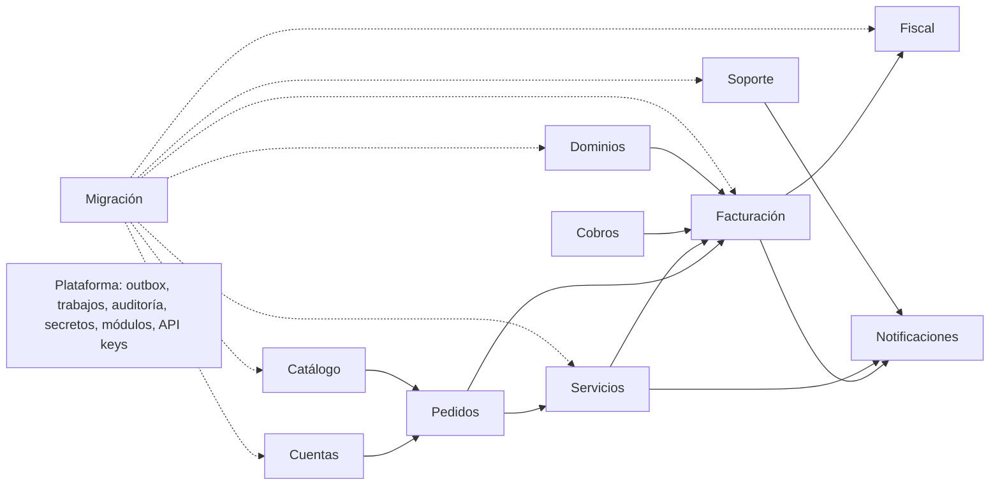
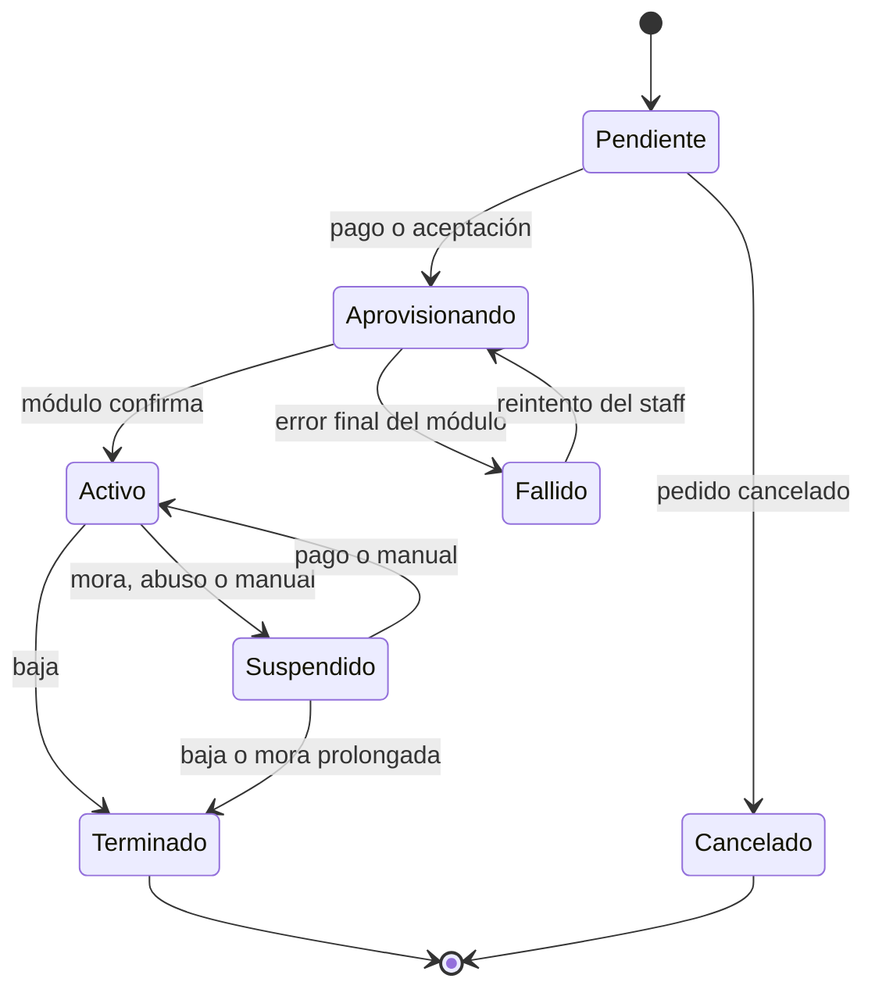
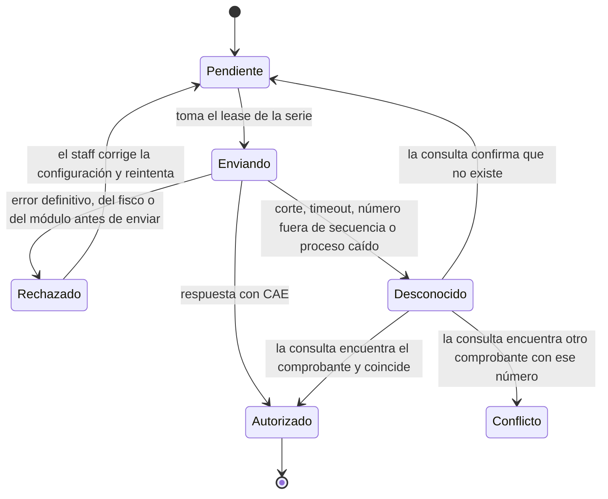
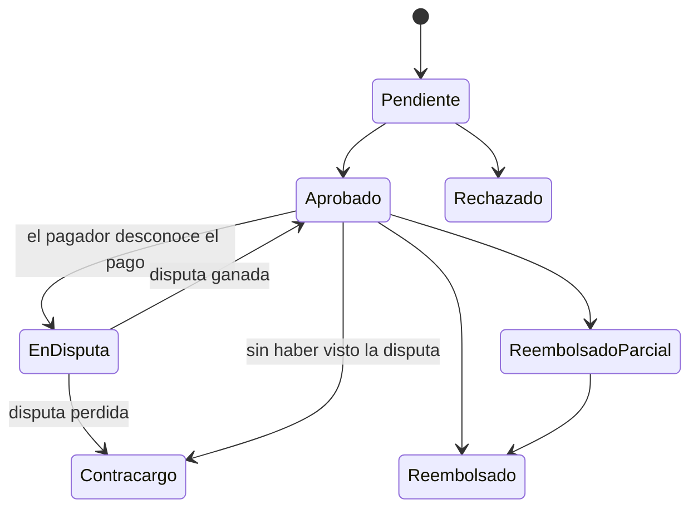
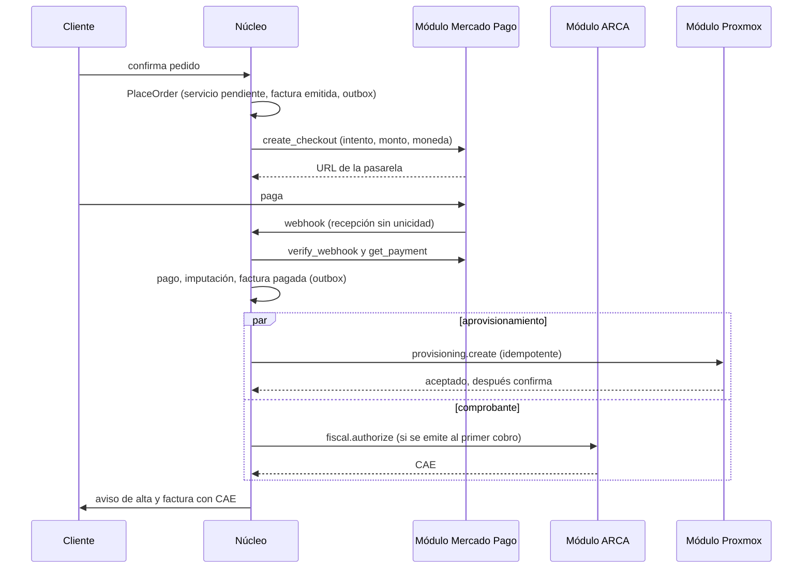

# Modelo de dominio v0

**Estado:** borrador v0 · **Parte de:** [diseño del núcleo](README.md)

Este documento define los conceptos del núcleo, sus estados y las reglas que nunca se pueden romper. Es un
diseño propio: no sigue el modelo de datos de WHMCS ni sus nombres. La correspondencia con los datos de WHMCS
vive en el importador (decisión D-17) y en las tablas de equivalencias de la API compatible (D-12). Las
fuentes de las normas citadas están en la sección 14.

Convenciones:
- Cada concepto tiene un nombre en castellano y su nombre en el código, en inglés, entre paréntesis.
- **Invariante** es una regla que el sistema garantiza siempre, con una restricción en la base o con una
  validación en el dominio que la prueba cubre.
- El dinero se escribe como `Money` (monto `decimal` más moneda ISO 4217). Ver la decisión D-04.

---

## 1. Mapa de módulos

El núcleo es un monolito modular (decisión D-03). Cada módulo es dueño de sus tablas y habla con los demás
por casos de uso o por eventos, nunca leyendo tablas ajenas.

| Módulo | Qué resuelve | Habla con módulos externos |
|---|---|---|
| Cuentas | Clientes, usuarios, contactos, identidad fiscal del cliente | Fiscal (padrón, opcional) |
| Catálogo | Productos, planes, precios por moneda, opciones, complementos, impuestos | No |
| Pedidos | Carrito, pedido, cupones | No |
| Servicios | Ciclo de vida de lo contratado, su aprovisionamiento, bajas y arrepentimientos | Aprovisionamiento |
| Facturación | Facturas, notas de crédito y débito comerciales, saldo a favor, numeración, recurrencia | No |
| Fiscal | Comprobantes fiscales y su emisión ante el fisco | Fiscal (ARCA en v0) |
| Cobros | Intentos, pagos, imputaciones, reembolsos, webhooks y suscripciones | Pasarelas |
| Dominios | Dominios y sus operaciones con registrars | Registrar |
| Soporte | Tickets, mensajes, departamentos, correo entrante | No |
| Notificaciones | Plantillas, correo saliente, webhooks salientes, constancias | No |
| Afiliados | Programa, enlaces, atribuciones, referidos, comisiones y sus cobros ([afiliados.md](afiliados.md)) | No |
| Contenidos | Base de conocimiento, novedades, descargas y estado de la red ([contenidos.md](contenidos.md)) | No |
| Migración | Corridas de importación, mapeos e incidencias | No |
| Plataforma | Outbox, trabajos, auditoría, ajustes, secretos, registro de módulos, API keys | Todos (transporte) |

---

## 2. Cuentas

| Concepto | Qué es | Invariantes |
|---|---|---|
| Cuenta (`Account`) | El cliente: persona o empresa. Tiene moneda e idioma preferidos, estado y marcas comerciales | Nunca se borra si tiene documentos. Se puede cerrar y anonimizar respetando el plazo legal de conservación |
| Identidad fiscal (`TaxIdentity`) | Tipo y número de documento (CUIT, CUIL, DNI, pasaporte o ID del exterior), condición frente al IVA, razón social, domicilio fiscal y país | Tiene vigencia: un cambio crea una versión nueva y los comprobantes guardan la versión usada. El CUIT se valida con dígito verificador |
| Usuario (`User`) | Quien entra al portal. Un usuario puede operar varias cuentas, con un rol en cada una (titular, facturación, técnico) | Contraseña con hash fuerte, 2FA con secreto cifrado, bloqueo por intentos |
| Contacto (`Contact`) | Destinatario de avisos de una cuenta, sin acceso al portal | Pertenece a una sola cuenta |
| Usuario del staff (`StaffUser`) | Personal del proveedor, con roles y permisos finos | Separado de los usuarios de clientes |

Marcas de cuenta que se modelan desde el día 1, porque son comunes en hosting:
- **Sin comprobante fiscal:** para cortesías o cuentas internas. La facturación sigue, pero no se emite
  comprobante.
- **Exenta del recargo por mora o de los recordatorios de vencimiento**, cada una por separado (sección 6.7).
- **Regla de cuenta** de impuesto, con motivo, vigencia y constancia, para los casos que la regla por país no
  resuelve (sección 6.2 y [docs/fiscal/impuestos.md](../docs/fiscal/impuestos.md)).
- **Idioma** de la cuenta, para elegir plantillas.

---

## 3. Catálogo

El detalle de opciones, complementos, paquetes, cupones y cambios de plan está en [catalogo.md](catalogo.md).

| Concepto | Qué es | Invariantes |
|---|---|---|
| Grupo de productos (`ProductGroup`) | Ordena la tienda y el catálogo | Conserva su ID al importar |
| Producto (`Product`) | Lo que se vende: servicio aprovisionado, servicio manual (por ejemplo bare metal), dominio o venta única. Tiene grupo, visibilidad, stock opcional, días de prueba gratis, clase de impuesto y a qué productos puede pasar el cliente | Un producto con servicios vivos no se borra: se oculta. El stock nunca queda negativo |
| Plan (`Plan`) | Ciclo de cobro: unidad (mes, año, pago único o gratis) y cantidad (1, 3, 6 o 12 meses, por ejemplo) | Un servicio guarda una copia del plan con el que se contrató |
| Precio (`PlanPrice`) | Monto y cargo de alta de un plan en una moneda, con fecha de vigencia y, si la moneda se sacó, fecha de cierre | Cambiar un precio no toca los servicios existentes. Para eso hay un cambio de plan explícito |
| Opción configurable (`OptionGroup`, `Option`, `OptionValue` y `OptionPrice`) | Variantes en lista, sí o no o cantidad, con valores y precio por moneda y ciclo (por ejemplo, RAM o jugadores). Un grupo de opciones se comparte entre productos. Cada opción dice en qué clave de los parámetros del módulo va lo elegido | Los valores elegidos se validan contra las opciones del producto. Un valor con precios no se ofrece donde no tiene |
| Complemento (`Product` con `Addon`) | Producto que se cuelga de un servicio (por ejemplo FastDL de un game server), de los productos que admite | Se contrata como un servicio hijo (sección 5) |
| Vínculo con módulo (`ModuleBinding`) | Instancia de módulo que aprovisiona el producto y sus parámetros, validados contra el esquema que publica el módulo | La instancia tiene que soportar las capacidades que el producto usa |
| Clase de impuesto (`TaxClass`) | Cómo se grava el producto: gravado (con alícuota), exento o no gravado | Todo producto tiene una |
| Regla de impuesto (`TaxRule`) | Qué alícuota corresponde según país y provincia del receptor (como código ISO 3166-2, al que el importador y las fichas normalizan el texto), su condición frente al IVA y la clase del producto, con vigencia | Para cada combinación se aplica una sola regla. Si no hay ninguna, el cálculo falla y nunca se asume cero, y una regla nueva con los mismos filtros y vigencia solapada no entra |
| Cupón (`Coupon`) | Descuento porcentual o fijo (fijo con moneda), aplicable a productos y ciclos, con ventana de validez, usos máximos, cantidad de ciclos y reglas por cuenta y por pedido | El servicio guarda cuántos ciclos de descuento le quedan, y el contador baja en cada factura. Así el descuento termina cuando debe, o antes si un cambio de plan pasa a un producto o un ciclo donde no vale. Los usos nunca pasan el tope |
| Paquete (`Bundle`) | Planes que se venden juntos, con sus unidades y un descuento porcentual por línea durante ciertos ciclos o para siempre | El pedido trae exactamente sus planes y sus líneas no toman cupón. El servicio guarda el descuento como el de un cupón |
| Métrica de uso (`UsageMetric`) | Lo que se mide de los servicios de un producto para cobrar el excedente: código del módulo, lo incluido, el paso, el precio por moneda con vigencia y el momento de cobro ([uso medido](uso-medido.md)) | Única por producto y código. La declara el módulo del producto, que tiene la capacidad `provisioning.usage` |

---

## 4. Pedidos

| Concepto | Qué es | Invariantes |
|---|---|---|
| Carrito (`Cart`) | Selección en curso, sin efectos | No reserva nada |
| Pedido (`Order`) | Lo confirmado: líneas con producto, plan, opciones, cantidad y precios congelados, más el cupón aplicado y la fecha de contratación | Confirmar un pedido es un solo caso de uso, `PlaceOrder`, que usan el portal, la API propia y la API compatible. En una transacción reserva stock, crea los servicios en estado pendiente y la factura inicial, y publica `OrderPlaced` en el outbox. Si el total es cero, se acepta sin factura, salvo que tenga un producto que acepta el staff. El primer período que no se factura porque el descuento lo deja en cero queda pago, como en la renovación. Cada producto dice si se aprovisiona al pagar, al pedir o cuando lo acepta el staff ([catalogo.md](catalogo.md)). El importador no lo usa: trae los pedidos históricos tal como están |
| Evaluación de fraude (`FraudCheck`) | Puntaje y motivos de un pedido, de un módulo de fraude o de las listas de bloqueo, y la decisión del staff ([fraude y acceso](fraude-y-acceso.md)) | Una por pedido, creada en la transacción de `PlaceOrder`. Mientras está pendiente o en revisión el pedido está retenido: ningún servicio suyo se aprovisiona, aunque la factura se pague. Rechazarlo cancela el pedido sin borrar nada |

Estados del pedido: `Pendiente`, `Aceptado` (pagado o aceptado a mano), `Completado` (todo aprovisionado) y
`Cancelado`. Un pedido con una línea de un producto que acepta el staff sigue pendiente hasta que el staff lo acepta,
aunque el resto ya se esté aprovisionando.

---

## 5. Servicios

Un servicio es lo contratado: una VPS, un game server, una cuenta de hosting, un FastDL o un servicio gestionado.

| Concepto | Qué es | Invariantes |
|---|---|---|
| Servicio (`Service`) | Cuenta, producto y copia del plan, precio congelado (precio unitario, moneda, cantidad, descuento con ciclos restantes), día de anclaje, estado deseado y observado, vínculo de módulo congelado, IDs externos y un uuid estable que los módulos dejan como marca en el sistema externo | El día de anclaje se conserva: si es 31, los meses cortos usan su último día y el mes siguiente vuelve al 31, sin deriva. El uuid no cambia nunca y es único |
| Servicio hijo (`Service` con `ParentServiceId`) | Complementos como FastDL | Tienen su propio ciclo de vida y sus propias operaciones de módulo. Si el padre se da de baja, los hijos también |
| Opción elegida (`ServiceOption`) | El valor o la cantidad que el servicio tiene de cada opción configurable | Una por opción. Lo elegido arma los parámetros del módulo del servicio |
| Cambio (`ServiceChange`) | Cambio de producto, de ciclo o de opciones, con su prorrateo hasta lo ya facturado ([catalogo.md](catalogo.md), sección 5) | A lo sumo uno esperando el pago de su factura. Bajar acredita con notas y se aplica enseguida. Subir se aplica con el pago |
| Trabajo de aprovisionamiento (`ProvisioningJob`) | Una operación pedida a un módulo: crear, suspender, reactivar, dar de baja, cambiar de plan o una acción propia del módulo | Tiene clave de idempotencia (servicio, operación y generación). Reintentos con espera creciente y tope. Los trabajos de un mismo servicio corren en orden y de a uno |
| Credenciales del servicio (`ServiceSecret`) | Contraseñas o llaves que el cliente necesita ver | Las genera el núcleo, salvo que el sistema externo las imponga (sección 6 del [protocolo](protocolo-modulos-v0.md)). Se guardan cifradas por campo (D-09), se muestran con confirmación y queda registro |
| Solicitud de baja o arrepentimiento (`CancellationRequest`) | Baja (inmediata o a fin de período) o arrepentimiento (dentro de los 10 días corridos de la contratación, con devolución de todo lo cobrado) [LDC] | Se pide con un botón público, sin iniciar sesión [954]. Genera un código de constancia que se muestra en pantalla y se manda por correo en menos de 24 horas. Nunca cobra por cancelar |

### 5.1 Estados del servicio

El estado tiene dos lados:
- **Deseado:** lo que el sistema quiere (por ejemplo, activo).
- **Observado:** lo que el módulo confirmó la última vez.

Tres marcas acompañan al estado. La fecha de baja programada (`CancelAt`) es una baja pedida a fin de
período: el servicio no renueva desde esa fecha y la corrida de mora lo da de baja ese día, sin pasar por la
mora. El motivo de suspensión (`SuspendReason`) distingue una suspensión del staff de una por mora: solo la de
mora se levanta con el pago. La exención de la suspensión automática (`NoAutoSuspend`) saca al servicio de la
suspensión por mora, no de la baja. Una baja que el módulo no pudo hacer (un error definitivo, sección 10 del
protocolo) también fija la fecha de baja al día: el servicio deja de renovar, la corrida de mora la vuelve a pedir
cada día y el staff ve la revisión. Si esa baja la había pedido la mora y el cliente paga, se levanta sola.

Un trabajo diario de reconciliación le pregunta el estado (`get_status`) a cada instancia que lo informa, por cada
servicio activo o suspendido sin una operación larga en curso, guarda lo observado y funde los IDs externos. Si lo
observado contradice al estado deseado deja una tarea de revisión al staff y no manda operaciones sola, porque lo
que el panel ve puede ser una decisión de una persona. La revisión se cierra sola cuando vuelven a coincidir. El
servicio nunca figura activo porque sí: se pasa a activo cuando el módulo confirma.

### 5.2 Mora por servicio

La mora se evalúa **por servicio**, no por cliente. Cada servicio guarda hasta dónde está pago: el inicio del
primer período facturado sin pagar, o el próximo a facturar si está todo pago. Avanza un ciclo por cada
renovación pagada por completo, también en las facturas importadas. Avanza en la misma transacción que la
imputación que deja la factura paga, así la mora nunca ve un pago confirmado sin su efecto. Un pago parcial no
alcanza para ninguno de los servicios de esa factura. Los plazos son configurables y se miden desde lo pagado:
- Pasada la gracia, se suspende el servicio. Al pagarse, se reactiva.
- Pasado el plazo de baja (general o propio del producto), se da de baja. Si toca el mismo día que la
  suspensión, va directo la baja. Con saldo a favor en la moneda del servicio que alcanza para un período con
  sus impuestos (lo mismo que exige la reemisión) no se da de baja: el cliente pagó y falta aplicarlo.
- La suspensión y la baja salen como trabajos y pueden esperar (un módulo que no responde, otro trabajo del
  mismo servicio). Antes de mandarlas al módulo se vuelve a aplicar la regla: si el cliente pagó mientras
  tanto, no se mandan. Si el pago llega con la suspensión ya en curso en el módulo, al terminar se reactiva. Una
  baja ya mandada no se deshace.
- Aparte, una factura impaga se anula con una nota de crédito pasados N días de su vencimiento, si no tiene
  nada pagado. Se decide con la factura bloqueada, así un pago que entra durante la corrida la deja paga y no
  anulada. La nota toma exactamente lo que falta acreditar en cada alícuota, exento y no gravado, y no se arma
  con las líneas, que en los importados pueden no coincidir con la cabecera. Una factura que no se puede anular
  queda en el log y no frena a las demás. Anularla no cuenta como pago: el servicio sigue en mora y llega a la
  baja. Si la misma corrida se repite, la factura ya anulada devuelve la nota existente.
- El que paga después de la anulación deja su dinero como saldo a favor. Ese pago encola la reemisión de los
  períodos que la anulación liberó, a los servicios que siguen sin pagar, y les aplica el saldo: si lo cubre, la
  factura queda paga, lo pagado avanza y el servicio se reactiva. Alcanza también a la factura de un pedido que
  nadie pagó, sea de un servicio recurrente o por única vez (vuelve con su cargo de alta y el servicio pendiente
  se aprovisiona), y a las renovaciones de dominio anuladas, que no tienen período: la línea nueva lleva la clave
  de la anulada con un contador. Sola, la reemisión solo factura lo que el saldo cubre entero. El staff la puede
  pedir sin ese tope por la API.
- Una nota de crédito parcial que deja la factura paga cuenta como pago: avanza lo pagado y reactiva.
- Sin facturación continua (lo habitual), un servicio con períodos facturados sin pagar no suma facturas.

Por ejemplo: gracia de 1 día, anulación a los 7, baja a los 14 y 2 en algunos productos. Los valores del sistema anterior los imprime el importador.

---

## 6. Facturación

Hay dos tipos de documentos:
- **Comerciales:** factura, nota de crédito y nota de débito. Son del núcleo.
- **Fiscales** (sección 7): existen solo cuando corresponde y se obtienen del fisco.

| Concepto | Qué es | Invariantes |
|---|---|---|
| Factura (`Invoice`) | Cuenta, moneda, fecha de emisión, vencimiento, líneas, totales por alícuota, total, copia de la identidad fiscal del receptor y, si corresponde, la cotización usada con su fuente | Se arma como borrador y se emite con un cierre explícito, que asigna número y la congela: líneas, importes, impuestos y receptor no cambian más (protegido en la base). Se corrige solo con notas. Los borradores no consumen número |
| Línea de factura (`InvoiceLine`) | Descripción, cantidad, precio unitario, importe y alícuota. Dice qué factura: renovación de un servicio, cargo de alta, cambio de plan, recargo, excedente de uso, concepto manual o, solo en documentos importados, ajuste de redondeo | Cada línea automática lleva una clave única según su origen: el período facturado (renovación), la línea de pedido (cargo de alta), el pedido de cambio (cambio de plan), la factura y la regla (recargo) o el servicio, la métrica y el corte (excedente de uso). Repetir la generación nunca duplica. Las manuales no llevan clave |
| Período facturado (`BilledPeriod`) | Servicio, rango [desde, hasta) y la línea de renovación que lo factura | **Dos períodos vigentes del mismo servicio nunca se superponen** (restricción de exclusión en la base). Si la factura se anula por completo, sus períodos se liberan y se pueden volver a facturar |
| Nota de crédito y de débito (`CreditNote`, `DebitNote`) | Documentos comerciales con líneas e impuestos, que referencian la factura original o un período. Tienen motivo: anulación total, ajuste, devolución, baja o cambio de plan | Congeladas al emitirse. Por cada alícuota, una nota de crédito nunca supera lo que falta acreditar del original, y la que completa el total toma exactamente ese resto |
| Serie de numeración (`NumberingSeries`) | Contador por tipo de documento | Se asigna al emitir, con lock, y sin huecos después de emitido |
| Movimiento de saldo (`CreditLedgerEntry`) | Libro de saldo a favor por cuenta y moneda, solo de altas | El saldo es la suma de movimientos y nunca es negativo. Nunca se edita un movimiento: se compensa con otro |
| Presupuesto (`Quote`) | Propuesta a una cuenta: asunto, moneda, vigencia, renglones sueltos o de un plan con su precio pactado, notas y el total con impuestos (sección 6.5) | No es un documento fiscal ni consume numeración. Se edita mientras está abierto y se convierte una sola vez en una factura o en un pedido |
| Ítem facturable (`BillableItem`) | Cargo suelto de una cuenta, por ejemplo horas de soporte: descripción, cantidad, precio, moneda, impuesto, servicio opcional y el día desde el que se factura (sección 6.6) | Se factura una sola vez: su línea lleva la clave `item:{id}`. Pendiente se cancela y facturado se corrige con una nota de crédito |
| Cotización (`ExchangeRate`) | Cuánto vale una moneda en otra, con su fuente (Banco Nación o carga del staff), su día y quién la cargó (sección 6.4) | Solo altas: un valor nuevo del mismo día es otra fila. Cada intento y cada servicio con precio en otra moneda guardan la que usaron |
| Ciclo de facturación (`BillingRun`) | Corrida que arma los borradores de renovación, los cierra y los emite | Cada servicio se procesa en su propia transacción corta. Dos corridas a la vez no duplican nada, por las claves de las líneas (D-07), y a un borrador que otra corrida ya emitió no se le agregan líneas. Una renovación de total cero no genera factura. Emite también los borradores que dejó una corrida cortada antes de emitir. Un servicio o un borrador que falla no frena a los demás: la corrida termina con error y se reintenta |

### 6.1 Estado de la factura

El estado se deriva de los importes, así nunca se desincroniza:

| Estado | Condición |
|---|---|
| Borrador | Todavía no se emitió |
| Emitida | Emitida, sin imputaciones ni notas de crédito |
| Pagada parcial | Tiene imputaciones y le queda saldo |
| Pagada | No le queda saldo y tiene imputaciones, o su total es cero (solo pasa con importados, porque el núcleo no emite documentos de total cero) |
| Anulada | Las notas de crédito suman su total. Lo que se había pagado vuelve como reembolso o como saldo a favor |

Una factura importada de total cero (el núcleo nunca emite una así) no tiene importes que digan su estado: toma
pagada o anulada según el estado que tenía en el sistema anterior.

El saldo de una factura es su total menos las notas de crédito y las imputaciones. Un contracargo revierte
imputaciones, así que la factura vuelve a deber. Las notas de débito son documentos aparte, con su propio
saldo.

### 6.2 Cálculo de impuestos y redondeo

Política v0, la que ARCA acepta en producción (decisión D-04):
- **Por factura y por alícuota.** El fisco no recibe líneas: por cada alícuota valida que el IVA coincida con
  la base por la alícuota, con una tolerancia chica (un centavo según el manual de WSFEv1 [M], a confirmar en
  homologación). Por eso los importes que valen se calculan sobre la
  suma de las líneas de cada alícuota.
- **Precios con IVA incluido** (lo que paga el consumidor final): por alícuota, el neto es la suma de los
  brutos dividida (1 + alícuota), redondeada a 2 decimales, y el IVA es el bruto menos el neto. El total
  cobrado nunca cambia por redondeo.
- **Precios con IVA aparte** (Factura A): por alícuota, el IVA es la suma de los netos por la alícuota,
  redondeada a 2 decimales.
- **Las líneas** muestran su parte, y la diferencia de redondeo va a la línea más grande de cada alícuota,
  para que todo sume exacto.
- **Redondeo comercial,** con la mitad hacia arriba (`MidpointRounding.AwayFromZero`).
- **Exterior:** la regla por país del receptor deja exento al cliente del exterior. Si
  el servicio se usa en el país, la exención no corresponde y la cuenta lleva una regla de cuenta con IVA.

### 6.3 Saldo a favor

La carga de saldo es un pago que entra al libro de saldo a favor, sin factura. Cómo se trata ante el fisco se
configura por emisor:
- **Al consumir** (por defecto): la carga no genera comprobante fiscal y la factura del
  consumo sí, se pague con dinero o con saldo. Así se evita la doble facturación, un error común en los sistemas
  que facturan la carga y también el consumo.
- **Al cargar:** para contratos donde el anticipo congela el precio, que según la Ley de IVA (art. 5, inciso
  b) [IVA] hace nacer el impuesto al cobrarlo. Queda definido para implementarlo cuando un proveedor lo necesite.

Qué modo corresponde lo decide el contador del proveedor.

El saldo a favor se consume solo al emitir cualquier factura, la de un pedido y la de una renovación, como hace
el sistema anterior con la aplicación automática prendida.

Tres caminos más llevan saldo a favor:
- **Carga desde el portal.** El cliente elige la cuenta, la moneda, el importe y cualquier pasarela que cobre en esa
  moneda, sin conversión, dentro del mínimo y el máximo que el proveedor fija por moneda. Es un intento sin facturas: el
  pago entra entero como saldo a favor y sigue el modo "al consumir". Sin límites configurados la carga no se ofrece.
- **Ajuste del staff.** Suma o resta con un motivo, nunca por debajo de cero. Queda un movimiento con el motivo y quién
  lo hizo, y una entrada en la auditoría con el importe y el saldo que dejó, sin el texto del motivo, que puede tener
  datos personales. Un error se corrige con otro ajuste. Pide su propio permiso (`credit.adjust`).
- **Aplicarlo a pedido.** El saldo que entró después de emitir una factura (por ejemplo el que dejó una nota de
  crédito o una carga) paga las facturas y notas de débito que se elijan, de la que vence antes a la que vence
  después, cada una con el saldo de su moneda. Lo usan el staff desde la factura y el cliente desde el pago.

### 6.4 Cotizaciones y otras monedas

Una cotización dice cuántas unidades de la moneda local vale una de otra moneda. Sirve para dos cosas:
- **Facturas en dólares cobradas en pesos.** Si la pasarela no cobra en la moneda de las facturas, el intento se
  arma en la que cobra, con el monto convertido. La cotización queda congelada en el intento con su fuente y el pago
  se imputa con ella, así lo que se cobra es exactamente lo que se imputa. Un pago que cubre lo que congeló el intento
  salda cada factura entera, aunque la cuenta inversa no dé exacta: un centavo de dólar vale casi quince pesos. Un pago manual en pesos de una factura en
  dólares se imputa con la cotización que da el staff o con la vigente. La que da el staff es positiva y con ocho
  decimales como máximo, y sin ninguna el pago no se registra: no queda como saldo a favor sin aviso.
- **Precios en dólares para cuentas en pesos.** Con el ajuste prendido, un plan sin precio en la moneda de la
  cuenta se vende con su precio en una de las monedas cotizadas. El servicio queda pactado en esa moneda y cada
  factura, la del pedido y las de renovación, sale en la moneda de la cuenta con la cotización de su día. El renglón
  dice el precio pactado, la cotización, su fuente y su fecha. El precio en pesos del servicio es el de la última
  factura, así la mora, el saldo a favor y los cobros siguen en esa moneda. Sin cotización vigente el pedido falla
  con el motivo, y la renovación no sale: la corrida termina con error y se reintenta.

Cuál vale cada día:
- La del Banco Nación (vendedor, tabla de divisas o de billetes) la trae un trabajo una vez por hora, de a uno entre
  todos los nodos, y guarda solo los valores que cambiaron. Vale desde el día siguiente al de su publicación: así un
  día entero cobra y factura con el mismo valor, que es el cierre del día hábil anterior. Está apagada por defecto:
  cada proveedor elige su fuente. No hay una API oficial: se lee la página pública, y si cambia y no se entiende, el
  trabajo falla a la vista y el staff carga la cotización a mano.
- La que carga el staff vale desde su día, le gana a la automática de esa fecha y sigue hasta que la fuente publique
  una más nueva. Queda en la auditoría con quién la cargó. Su fecha va de hoy hasta el tope de abajo: una más vieja
  no valdría nunca y se rechaza al cargarla.
- Una más vieja que el tope (5 días por defecto, para cubrir un fin de semana largo) no se usa, y la conversión
  falla a la vista.
- Los factores se redondean a 8 decimales y los importes convertidos a 2, con la mitad hacia arriba. Cada renglón
  de un intento se convierte en forma acumulada, así la suma da exactamente el monto del intento.

El portal muestra el equivalente en la moneda local de lo que está en otra, con la cotización, su fuente y su
fecha: en el presupuesto y en cada medio de pago que cobra en otra moneda. La cotización fiscal de un comprobante
en moneda extranjera es otra cosa: la informa el fisco (sección 7).

### 6.5 Presupuestos

El staff arma un presupuesto para una cuenta y lo edita mientras está abierto. Mandarlo lo deja a la vista del
cliente y le manda un aviso con un enlace. Cada envío es un aviso nuevo.

- **Estados:** borrador, mandado, rechazado, aceptado y facturado, y aceptado con pedido. Solo un borrador se
  borra. Uno que el cliente vio se marca rechazado.
- **Total:** se calcula al guardarlo con el mismo motor de impuestos que la factura (sección 6.2) y la ficha del
  día: un renglón con plan lleva la categoría del producto del plan, la misma con que lo factura el pedido (por
  ejemplo telefonía al 27 % o exento), y el total suma los tributos de comprobante que le tocarían al emitir, como una
  percepción. Así el importe que el cliente acepta es el que se le factura. Un presupuesto que no cierra, por ejemplo
  una bonificación gravada mayor que lo gravado, no se guarda. La factura vuelve a calcular con la ficha del día en
  que se convierte.
- **Renglones con plan:** cantidad entera y un precio que no sea negativo, con dos decimales como máximo. El plan
  tiene que estar activo y no puede ser de un complemento, que va colgado de un servicio: el pedido del presupuesto
  no tiene de cuál. Las reglas del catálogo se miran al guardarlo, no recién al aceptarlo.
- **Vigencia:** 30 días por defecto. Vencido, el cliente ya no lo acepta. El staff lo puede convertir igual, por
  ejemplo si se aceptó por teléfono, o extender la vigencia y mandarlo de nuevo.
- **Conversión:** una sola vez, con el presupuesto bloqueado, así dos conversiones a la vez no arman dos
  facturas. A factura van todos sus renglones, con una clave por renglón que impide facturarlo dos veces. A pedido
  (solo si cotiza algún plan y está en la moneda de la cuenta), cada renglón con plan crea su servicio con el precio
  pactado, que sigue en las renovaciones, y el resto va en la misma factura del pedido. Un producto que no se pide
  por cantidad va de a una unidad por línea, como en la tienda: su renglón por N crea N servicios de una unidad con
  el mismo precio. Por eso un presupuesto no puede dar más de 200 renglones en la factura del pedido, el tope de una
  factura manual. El precio pactado reemplaza al del catálogo y a su cargo de alta, así que el plan no necesita
  precio en esa moneda. El pedido lleva la referencia del presupuesto: repetirlo devuelve el mismo pedido.
- **Duplicar:** cualquier presupuesto, también uno cerrado, se copia en un borrador nuevo con su asunto, moneda,
  renglones y notas, la vigencia de siempre desde hoy y el total con la ficha del día.
- **Desde el portal:** el cliente acepta o rechaza un presupuesto mandado y vigente de una de sus cuentas. Aceptado
  pasa a pedido si cotiza planes en la moneda de la cuenta y si no a factura, como lo convertiría el staff, y el
  cliente va directo a pagarla. Uno ajeno o en borrador da lo
  mismo que uno que no existe.

### 6.6 Facturas manuales e ítems facturables

- **Factura manual:** renglones propios con descripción, cantidad, precio y tratamiento de impuesto. Gravado va con la
  categoría de servicios digitales, como un producto gravado, y exento y no gravado con las suyas: el motor resuelve la
  alícuota con las reglas generales y las de la cuenta (sección 6.2). Los precios van en el modo de carga por defecto
  de la moneda, como los precios nuevos del catálogo (con IVA en pesos y sin IVA en dólares, de fábrica). Moneda y
  vencimiento salen de la cuenta y del plazo de siempre si no se dicen. Queda en borrador sin número o se emite
  enseguida, con el mismo cierre que las demás, y consume el saldo a favor al emitirse. Solo un borrador manual se
  descarta: una emitida se anula con una nota de crédito. Presupuestos e ítems facturables siguen las mismas reglas.
- **Ítem facturable:** un cargo suelto que se factura una sola vez. La corrida del día que tiene asignado lo suma al
  borrador de la cuenta en su moneda y su modo de carga, junto con las renovaciones, o arma uno nuevo. El staff también lo puede
  facturar en el momento, aunque su fecha sea posterior: una factura por moneda, emitida enseguida. La corrida y el
  staff toman la cuenta y cada ítem bloqueados, así uno cancelado o facturado a la vez no entra dos veces.

### 6.7 Recargo por mora y recordatorios

- **Recargo por mora:** pasados N días del vencimiento, una factura impaga recibe una nota de débito por un
  porcentaje de lo que debe más un fijo por moneda, los dos configurables. Apagado por defecto. La nota se reparte
  como las alícuotas de la factura, con la categoría y la leyenda de sus renglones, así lleva el impuesto de lo que
  recarga (Ley de IVA, art. 10), y suma los tributos de comprobante que correspondan, como una percepción. Por eso el
  porcentaje va sobre lo que se debe sin los tributos de comprobante de la factura: la nota es el porcentaje de todo
  lo que se debe, sin recargar una percepción y sumarle otra. Cada parte es un bruto y la nota cierra en el recargo
  también con precios sin IVA, donde el IVA es la diferencia, como en un precio con IVA. Una nota de débito no recibe
  recargo. La nota de una factura importada va con el receptor de la cuenta, porque la importada no lo trae. Hay una
  sola por factura y se decide con la factura bloqueada: una que se pagó mientras tanto no la recibe. Un recargo que no salió
  por una caída sale dentro de los 7 días siguientes y no más tarde, así prender el recargo no castiga deudas viejas.
  Una factura que la misma corrida va a anular por impaga no se recarga, y el recargo impago de una factura anulada
  se anula con ella, en la misma transacción y con el mismo motivo, la anule la mora, el staff o un reembolso. Uno ya
  cobrado queda y lo resuelve el staff. El staff lo puede aplicar a pedido desde la factura, sin esperar los días de la corrida pero
  nunca antes del vencimiento. Un recargo que falla no frena la anulación de las impagas de la misma corrida, que
  termina con un solo error con todas las fallas y se reintenta.
- **Recordatorios:** los días antes del vencimiento y después de vencida se configuran como listas, por ejemplo 7, 3
  y 1 antes y 3, 10 y 20 después. Valen para las facturas y para las notas de débito del recargo, que tienen su
  propio vencimiento. Cada aviso sale una sola vez por documento y por día de la lista, y cada día cubre hasta el
  siguiente: lo que no salió por una caída sale después, sin mandar dos el mismo día.
- **Exenciones:** una cuenta se puede eximir del recargo y de los recordatorios, cada uno por separado. El cambio
  queda en la auditoría.

Una nota de crédito sobre lo ya pagado revierte las imputaciones de la factura, de la más nueva a la más vieja,
y deja ese importe como saldo a favor con su pago de origen. Así lo imputado de una factura es siempre la suma
de sus imputaciones vigentes, y el pago sigue aplicado porque su plata está en el saldo.

---

## 7. Fiscal

El núcleo es dueño del comprobante y de su diario de emisión. La comunicación con el fisco la hace un módulo
de tipo fiscal: en v0, el de ARCA.

| Concepto | Qué es | Invariantes |
|---|---|---|
| Perfil fiscal del emisor (`IssuerFiscalProfile`) | CUIT, razón social, condición frente al IVA, inicio de actividades, ingresos brutos, domicilio, puntos de venta con su uso (A, B, E), certificado, ambiente (homologación o producción) y momento de emisión | El certificado y su clave privada se guardan cifrados (D-09). Se avisa antes de que venzan. Cada punto de venta es exclusivo de este sistema. Homologación y producción no comparten emisor: el pase a producción sale solo del de homologación y crea otro, que emite solo lo emitido desde que se activa |
| Comprobante fiscal (`FiscalDocument`) | Uno por cada factura o nota que corresponda. Tipo, punto de venta, número, fecha, concepto, período de servicio, vencimiento de pago, receptor (documento y condición frente al IVA), moneda y cotización, importes por alícuota, comprobantes asociados, CAE y su vencimiento, y datos para el QR | **Uno y solo uno por documento comercial** (restricción única), salvo los importados (D-17). Autorizado, no cambia más |
| Emisión fiscal (`FiscalEmission`) | Diario de intentos de emisión: número propuesto, fecha, vencimiento de pago y cotización de cada intento, con pedido y respuesta sin datos sensibles | Se emite de a uno por serie (emisor, punto de venta y tipo), con un lease que se mantiene mientras el resultado sea incierto. Nunca se llama al fisco dentro de una transacción de base |

Reglas de la emisión:
- **Fecha:** la del día del intento, nunca anterior. El fisco rechaza fechas anteriores a la del último
  comprobante autorizado de la serie y solo acepta una diferencia acotada con el día de emisión [M]. El
  vencimiento de pago informado nunca es anterior a la fecha del comprobante.
- **Período de servicio:** en una factura consolidada va desde el inicio más temprano hasta el fin más tardío
  de sus líneas.
- **Moneda extranjera:** el comprobante va en la moneda del documento, con la cotización oficial que informa el
  fisco para su fecha. Si el cobro es en la misma moneda se informa así (RG 5616) [5616]. Eso sale del medio de
  pago del servicio facturado, con un mapa de medios y un valor por defecto en los ajustes del emisor. Las notas
  usan la cotización y la cancelación de su original. Una factura E que se cancela en la misma moneda va sin
  cotización y el fisco registra la oficial: el núcleo la consulta después de autorizar y la guarda, para el QR
  y para las notas. Si a una nota le falta la cotización del original, por ejemplo de uno importado, la consulta
  al fisco y, si no la obtiene, reintenta más tarde: en exportación ARCA exige la misma cotización del
  comprobante asociado (error 2053 del manual de WSFEX). La regla para facturas en dólares cobradas en pesos se
  cierra con el contador en la prueba de ARCA.
- **Exportación (factura E):** corresponde cuando el receptor es de otro país o tiene la condición "Cliente del
  Exterior". Lleva el código de país y la CUIT genérica del país que publica ARCA, de un mapa por código ISO con
  un país por defecto, más el domicilio en una línea, la forma de pago, el idioma y la unidad de los renglones.
  Solo la factura informa la cancelación en la misma moneda, y en ese caso va sin cotización. El ID de pedido
  que exige el fisco sigue al mayor entre el último que informa y el último propio, se guarda antes de llamar y
  se repite en cada reintento de la misma emisión, porque con el mismo ID el fisco devuelve lo que ya autorizó.
- **Receptor rechazado:** si el fisco rechaza por datos del receptor (por ejemplo, una CUIT inactiva o una
  condición frente al IVA inválida), la factura se anula con una nota de crédito sin comprobante fiscal,
  porque el original no tenía. Se corrige la ficha y se emite otra factura. Los períodos de la anulada se
  liberan.

### 7.1 Estados de la emisión

Reglas clave:
- Ante un resultado incierto no se reintenta a ciegas: se consulta el comprobante por su número, y solo si no
  existe se vuelve a emitir. Antes de darlo por inexistente se espera un rato, por si el pedido sigue en
  proceso.
- Un rechazo por número fuera de secuencia no es un rechazo: el comprobante pudo haberse autorizado en un
  intento anterior. Es un resultado incierto.
- Si el proceso cae con una emisión en `Enviando`, al vencer el lease pasa a `Desconocido`.
- Un error definitivo del módulo (datos, configuración o firma inválidos) es como un rechazo: no se autorizó
  nada y la emisión queda rechazada con el motivo, sin frenar la cola, y su trabajo queda muerto y visible
  para el staff. Un DNI se carga con 7 u 8 dígitos y sin puntos, y la condición frente al IVA es obligatoria,
  así esos errores aparecen al cargar la ficha.
- Si el resultado nunca se aclara, después de 5 intentos la emisión queda pendiente con el motivo y su
  trabajo, muerto y visible para el staff.
- La consulta adopta un comprobante solo si coinciden todos los datos que el fisco informa (fecha, total,
  receptor, concepto, período, vencimiento, moneda, IVA e ID de pedido) y ninguna otra emisión de la serie
  propuso ese número. Si hay dos candidatos, nadie lo adopta y la emisión pasa a `Conflicto`.
- Un documento que ya tiene comprobante no se vuelve a emitir, aunque llegue otro aviso. La emisión y la serie
  llevan token de concurrencia, así un escritor atrasado, por ejemplo un worker que perdió el lease, no pisa
  lo que guardó otro.
- `Conflicto` frena la serie hasta que el staff lo resuelve.
- Una nota cuyo original no tiene comprobante fiscal no se manda al fisco, que exige el comprobante asociado: espera
  o se rechaza, como dice más abajo. La nota lleva el receptor congelado en la factura y sigue la clase de su
  comprobante, aunque la ficha haya cambiado. Una importada no trae receptor y la nota va con el de la cuenta. Si la
  factura importada tiene más de un comprobante, se asocia la última factura.
- Un cliente del exterior va en clase E solo si el documento no lleva IVA. Con una regla que lo grava, va en
  clase B con la condición de cliente del exterior, porque la factura de exportación no informa IVA.
- Con cancelación en la misma moneda extranjera el comprobante va sin cotización y se guarda la que registró el
  fisco. En el mercado interno cada comprobante pide la cotización de su propia fecha. Si el fisco todavía no la
  publicó, la emisión espera unas horas y vuelve a intentar.
- Una falla imprevista en la emisión muere visible en el primer intento, con el motivo en la emisión, y libera
  la cola. El barrido diario (sección 7.2) vuelve a encolar lo que sigue sin comprobante.
- Una vez por día se compara el último número del fisco con el último registrado para cada serie, y la
  emisión lo compara también, salvo que la serie se haya comprobado hace menos de un día: entonces propone el
  siguiente sin consultar, y un número que otro sistema usó vuelve como incierto y la consulta lo descubre. Si
  el fisco va adelante, se concilia antes de seguir, y la serie deja de darse por comprobada hasta que vuelva a
  coincidir. El detalle está en la sección 9.4 del [protocolo](protocolo-modulos-v0.md).
- Cada emisión y el control diario corren con la clave de entidad de su serie: una serie emite de a uno y en
  orden, y dos series no se esperan entre sí.
- Una cotización que no es la que el fisco publica para la fecha del comprobante (la que una nota de
  exportación copia de su factura) se comprueba contra la orientativa antes de llamar: fuera del 2 % al 400 %
  (validación 10119 de WSFEv1) la emisión queda rechazada con el motivo, sin viajar al fisco. Así una factura
  importada con cotización 1 no manda una nota inválida.
- Lo frenado lo resuelve el staff por la API propia, con permiso fiscal y auditoría. Adoptar: el fisco tiene un
  comprobante con el número propuesto y el staff confirma, repitiendo el código de autorización que informa el
  fisco, que es el de este documento. Reintentar: una rechazada o en conflicto vuelve a pendiente y se encola.
  Ajustar la serie: el último número registrado, con motivo, y la serie vuelve a consultar al fisco antes de
  emitir. Nada de eso se hace sobre una serie con una emisión en curso ni, con la traba de producción puesta,
  contra una instancia de producción.
- El número comercial del documento sale del contador justo antes de confirmar la transacción que lo emite, así
  la fila del contador, que pone en fila a todos los que emiten ese tipo, queda bloqueada lo menos posible.
- Una nota cuyo original todavía no tiene comprobante espera, con el motivo en su emisión, y sale asociada en
  cuanto el original tiene el suyo: la autorización del original la encola en la cola de su serie, y la que
  igual quede esperando la vuelve a encolar el barrido diario. Así la nota de débito del recargo por
  mora, que es plata que se cobra, sale aunque el emisor emita al primer cobro. Si el original nunca lo va a tener
  (importado sin comprobante, anulado sin cobro o emitido antes del pase a producción, que es del emisor de
  homologación) la nota queda rechazada (D-05).
- Una factura anulada sin un peso cobrado antes de tener comprobante no lleva uno, ni ella ni sus notas: el
  barrido no la encola ni el último día del mes y un reintento del staff la rechaza.
- Un error definitivo en la consulta de un comprobante incierto (certificado vencido, traba del módulo) muere
  visible en el primer intento y libera la serie, igual que en el envío. El barrido la vuelve a encolar cuando
  el staff corrige.
- Un comprobante en moneda extranjera autorizado sin la cotización que el fisco registró (la consulta de
  después falló) guarda su CAE igual, y un trabajo propio completa la cotización, que el QR exige: se
  reintenta y el barrido diario revive el que murió.

### 7.2 Momento de emisión

La Ley de IVA (art. 5, inciso b) [IVA] y la RG 5866 [5866] fijan un límite: el comprobante tiene que existir
a más tardar en el primer cobro, aunque sea parcial, o al terminar la prestación, lo que pase primero. Para
servicios continuos, la RG 5866 lleva ese fin al último día del mes. Si el hosting entra en ese caso está por
confirmar. Dentro del límite, el emisor elige:
- **Al emitir la factura** (por defecto): nunca llega tarde.
- **Al primer cobro**, con red: un trabajo emite el último día del mes lo que siga sin comprobante. El barrido
  cuenta como el de su día aunque el corredor lo tome al siguiente, y lo impago de un mes ya cerrado sale en el
  primer barrido que corra.

Un cobro parcial emite el comprobante de la factura completa. La carga de saldo sigue la sección 6.3.

---

## 8. Cobros

| Concepto | Qué es | Invariantes |
|---|---|---|
| Intento de cobro (`PaymentAttempt`) | Pedido de cobro de una o más facturas o de un monto, en la moneda que cobra la pasarela. Si difiere de la de las facturas, congela el monto convertido, la cotización y su fuente | Tiene clave de idempotencia. **Antes de cobrar se comprueba el estado de la factura,** nunca después |
| Pago (`Payment`) | Lo efectivamente cobrado: instancia de pasarela, ID externo, monto y moneda cobrados y comisión | **Restricción única (instancia, ID externo de pago).** Se validan monto, moneda y referencia contra el intento |
| Imputación (`Allocation`) | Cuánto de un pago o del saldo a favor se aplica a cada factura, en la moneda de la factura y con la cotización del intento | La suma imputada nunca supera el pago. Lo que sobra va a saldo a favor en la moneda del pago |
| Reembolso (`Refund`) | Devolución total o parcial de un pago: la pide el staff, la informa la pasarela o es un contracargo | Primero se emite la nota de crédito y después se mueve la plata. Si la pasarela falla o venció su plazo, el importe queda como saldo a favor y el staff lo resuelve. Lo devuelto de un pago nunca supera lo cobrado |
| Recepción de webhook (`WebhookReceipt`) | Lo que llega de la pasarela, crudo, con sus encabezados | Sin unicidad, con tope de tamaño y de pedidos. Se responde enseguida. Un aviso inválido se queda sin cuerpo y se borra a los `Workers:KeepDone` días. Uno válido conserva la fila y el cuerpo se vacía a los `Workers:KeepWebhookBodies` días. El evento conserva la unicidad `Workers:KeepGatewayEvents` días |
| Evento de pasarela (`GatewayEvent`) | Un evento ya verificado por el módulo | **Restricción única (instancia, ID de evento).** Lo procesa un trabajo aparte |
| Suscripción de pasarela (`GatewaySubscription`) | Débito recurrente que administra la pasarela (por ejemplo Mercado Pago), con la constancia del consentimiento | Cada cobro entra como pago de la suscripción (por su ID en la pasarela o por la referencia del núcleo) y se imputa primero a las facturas impagas de la cuenta en su moneda con un servicio mensual y después a las demás, las más viejas primero. Se ofrece y se cambia solo con `Payments:SubscriptionsEnabled`, pero el cobro de una vigente se registra siempre |
| Medio guardado (`SavedPaymentMethod`) | Cuenta, instancia, IDs externos del cliente y del medio, lo que se muestra (marca, últimos 4 y vencimiento), estado y la constancia del consentimiento | **Único por instancia e ID externo del medio.** A lo sumo uno del débito automático por cuenta. Nunca el número ni el código de seguridad |
| Cómo se ofrece una pasarela (`GatewaySetup`) | Ambiente, nombre y orden en el portal, monedas, débito automático y la última prueba de conexión | Para ofrecerla hacen falta una prueba correcta y una moneda |
| Cuenta para transferir (`TransferAccount`), movimiento del extracto (`BankMovement`) y aviso de transferencia (`TransferNotice`) | Las cuentas del proveedor, los créditos del extracto y los "Ya transferí" de los clientes | **Movimiento único por cuenta y referencia del banco.** El aviso no es un pago |

El cobro es por redirección. El débito automático va por la suscripción de la pasarela o con un medio guardado: con
el medio guardado el núcleo decide cuándo y cuánto cobrar, y comprueba la factura antes de cada cobro. El intento
guarda quién inicia el cobro (el cliente o el comercio) y el medio usado. Un intento automático rechazado guarda si
admite reintento. El detalle está en la [guía de cobros](../docs/cobros/README.md).

Lo construido hasta ahora: el intento cubre una o varias facturas de una sola moneda y de una sola cuenta, de la
que vence antes a la que vence después, o ninguna si es una carga de saldo (sección 6.3). Se cobra en esa moneda o,
si la pasarela no la cobra, convertido con la cotización vigente, que queda congelada en el intento (sección 6.4).
Un pago de un intento propio se registra contra él, y si el monto o la moneda no coinciden entra a saldo a favor. Un pago sin
intento propio no se registra, porque puede ser de otro sistema que usa la misma cuenta, salvo el cobro de una
suscripción propia con el débito por suscripción prendido. La conciliación corre
cada hora sobre los pagos que cambiaron en los dos días anteriores. Un pago se imputa solo a facturas y notas de
débito: si piden una nota de crédito, ese monto queda como saldo a favor. Los importes de pagos, imputaciones y
saldo llevan dos decimales como máximo. Los reembolsos y los contracargos siguen la sección 8.2.

### 8.1 Estados del pago

Solo valen las transiciones del diagrama: un aviso viejo, repetido o fuera de orden que no encaja se registra
y se ignora. El contracargo directo existe porque Mercado Pago no avisa los contracargos: la conciliación
encuentra el pago ya contracargado. Un pago que el núcleo ve por primera vez ya en disputa, devuelto o
contracargado pasó por aprobado: se imputa igual y después se saca lo que volvió al pagador.

### 8.2 Reembolsos y contracargos

Lo devuelto se cuenta por importe y no por estado: el pago guarda cuánto volvió al pagador, y la pasarela
informa cuánto lleva devuelto en total. Así un aviso repetido no devuelve dos veces. Cada devolución queda
registrada como un reembolso, con su origen.

- **Del staff** (sección 12.4). En una transacción se emite la nota de crédito contra la factura, que deja lo
  ya pagado como saldo a favor, y se encola el pedido a la pasarela con la clave de idempotencia
  `refund-{reembolso}`. Se pide lo que la nota devolvió, hasta lo que queda de ese pago: si la factura se pagó
  con más de un pago, el resto sigue como saldo a favor. Cuando la pasarela acepta, el importe sale del saldo a
  favor. Si la rechaza (por
  ejemplo, porque venció su plazo), si el pago no entró por una pasarela, o si en el último intento sigue sin
  respuesta cierta, el reembolso queda fallido y el importe sigue como saldo a favor. Si después la pasarela
  muestra la plata devuelta (por ejemplo, el staff la devolvió desde su panel), el reembolso fallido se cierra
  con eso. Mientras un reembolso del staff espera respuesta, cuenta como devuelto para no descontarlo dos veces.
- **Informado por la pasarela**, sin nota previa, por ejemplo hecho desde su panel. Lo devuelto sale, en este
  orden, del saldo a favor que dejó el mismo pago (también lo que le devolvió una nota de crédito, sección 6.3),
  de sus imputaciones vigentes de la más nueva a la más vieja (la factura vuelve a deber) y del resto del saldo
  a favor de la cuenta.
- **Contracargo:** sale todo lo cobrado que no se había devuelto, en el mismo orden.

Cuando una factura pagada vuelve a deber, lo pagado de sus servicios vuelve al inicio del período, y la mora
de la sección 5.2 sigue desde ahí. Lo que no se puede cubrir porque el saldo ya se consumió queda anotado en
el reembolso como no cubierto y lo resuelve el staff. Las facturas importadas no traen sus períodos, así que
revertir su pago no mueve lo pagado de sus servicios.

---

## 9. Dominios, soporte y notificaciones

| Concepto | Qué es | Invariantes |
|---|---|---|
| Dominio (`Domain`) | Nombre, cuenta, instancia de registrar, estado, vencimiento, renovación automática, nameservers, bloqueo, protección de identidad, código EPP y titular propio si no es el de la cuenta. Precio congelado de la renovación con su modo de carga (con impuesto incluido o sin impuesto), próximo período a facturar y hasta dónde está pago. Estado en el registro y fecha de la última sincronización | El código EPP se guarda cifrado y el de una transferencia se borra al completarse. Un nombre vive en una sola cuenta a la vez (índice único sobre los vivos). Los dominios sin API, como los .ar de NIC Argentina, usan un registrar "manual" que genera tareas para el staff. Estados: pendiente, activo, en gracia, vencido y cancelado, que salen de lo pago: pasado lo pago entra en gracia y pasada la gracia queda vencido. El estado en el registro lo trae aparte la sincronización diaria, y solo uno que se fue a otro registrar deja de renovarse, con el renglón de su renovación sin pagar acreditado. La renovación se factura con su propia anticipación, como servicio digital y en el borrador de su modo de carga, también la de uno en gracia sin la renovación facturada, y una de precio cero avanza el período sin factura. Renovar ahora factura el próximo período con la misma clave de renglón que la corrida. Una renovación que el staff anula con una nota de crédito (toda la factura, o el renglón del dominio entero) vuelve a estar por facturar, y la factura nueva del período lleva la clave con cuántas hubo antes y el texto y el precio del renglón anulado, porque los renglones emitidos no cambian y el precio de un período queda congelado al facturarlo. Lo que anula la mora no vuelve a estar por facturar: lo reemite Renovar ahora, con vencimiento a los días de hoy, o la reemisión cuando el cliente paga después y su saldo lo cubre. Un vencido que paga tarde pide la renovación y vuelve a activo solo si el registro la acepta. La zona DNS y los reenvíos no se guardan: los tiene el registrar, se leen en el momento y se cambian enteros. La gestión de DNS, el reenvío y la protección son opciones que pueden tener precio por año: con precio se contratan al pedir o desde el dominio (lo que queda del período se factura y la opción se aplica al pagarse), y su precio queda congelado dentro de la renovación hasta que se dan de baja. Una extensión puede dejar de ofrecer alguna, y el dominio que ya la tiene la conserva. Los que no se renuevan solos reciben un aviso por umbral de días y por vencimiento (evento `DomainExpiring`). El cliente recibe otro cuando el registrar termina el registro, la transferencia o la renovación (`DomainRegistered`, `DomainTransferred` y `DomainRenewed`) y cuando la transferencia falla (`DomainTransferFailed`), en la misma transacción y uno por operación |
| Operación de dominio (`DomainOperation`) | Registro, transferencia, renovación, nameservers, bloqueo, código EPP, titular, zona DNS, reenvíos o protección de identidad, como trabajo idempotente | Igual que los trabajos de aprovisionamiento, con la clave de entidad del dominio. La renovación es única por dominio y vencimiento, y se pide al pagarse o, a precio cero, al llegar su anticipación. Registro y transferencia esperan la factura del pedido paga. La última de cada tipo que falló se reintenta como intención nueva (la transferencia, con otro código EPP), también la renovación de un dominio activo o vencido. Un pedido que falló también se cancela: la factura del pedido se anula con una nota de crédito y lo pagado queda como saldo a favor. Un pedido cuya factura se anula entera (la mora o el staff) se cierra solo y el nombre queda libre. Lo que ya está en el registrar se cancela solo si falla |
| Tarea del staff (`StaffTask`) | Lo que el módulo manual le pide a una persona: alta de un servicio sin módulo, suspensión, baja o trámite de un dominio | Única por instancia y clave de idempotencia. Un servicio o dominio tiene a lo sumo una abierta. Nunca guarda secretos |
| Precio por TLD (`TldPrice`) | Precio de registro, renovación y transferencia por instancia de registrar, moneda y años | Con vigencia: un cambio es una fila nueva y los dominios ya contratados conservan su precio. Se carga a mano, se importa de los costos que publica el registrar con cotización, margen, impuesto y redondeo, o desde un CSV, siempre con una propuesta antes de guardar |
| Precio de una opción (`DomainOptionPrice`) | Precio por año de la gestión de DNS, el reenvío de correo o la protección de identidad, por moneda | Con vigencia, como el de los TLD. Sin precio la opción es gratis. Los dominios que la contrataron conservan el suyo |
| Opciones de una extensión (`TldOptions`) | Qué opciones del dominio se ofrecen en una extensión | Sin fila se ofrecen todas, y cada una además solo si su registrar declara la capacidad. Una que no se ofrece no se pide ni se contrata, y los dominios que ya la tienen la conservan |
| Ticket (`Ticket`) y mensaje (`TicketMessage`) | Cuenta o correo de origen, departamento, número público, estado, prioridad y asignado. Mensajes del cliente, del staff o del sistema, con adjuntos, y notas internas que el cliente no ve. Un ticket se puede unir a otro | El número público es distinto del ID interno. Los adjuntos van a una tabla aparte, con tope y tipos permitidos. El HTML de un correo se pasa a texto. Un ticket unido apunta a uno que no está unido, y sus mensajes pasan a ese |
| Departamento (`Department`) | Casilla de correo (IMAP), visibilidad en el portal, solo para clientes, confirmación automática, casilla del equipo y encuesta | La contraseña de la casilla va cifrada y atada al servidor (D-09) |
| Regla de escalamiento (`EscalationRule`) y escalación (`TicketEscalation`) | Departamentos, estados, prioridades y minutos sin un mensaje nuevo. Cambia departamento, prioridad, estado o asignado, avisa al asignado o al equipo y a las personas que nombra, deja una nota y le responde al cliente | Una regla se aplica una vez por espera: única por regla, ticket y último mensaje |
| Encuesta (`TicketFeedback`) | Calificación del 0 al 10 y comentario del solicitante al cerrarse el ticket | Una por ticket. El enlace lleva una ficha propia y sirve sin iniciar sesión |
| Plantilla (`Template`) | Plantilla de correo o PDF por evento e idioma, en sintaxis tipo Liquid. Las de fábrica vienen con el sistema y el proveedor las reemplaza | Se renderiza con lista de permitidos, codificación HTML y límites (D-13). Si una editada falla, sale la de fábrica |
| Correo saliente (`OutboundEmail`) | Aviso ya armado, en la cola de envío con reintentos | Nunca se pierde un aviso por caída del servidor de correo: los reintentos cubren casi un día. Una clave por evento impide armar dos veces el mismo aviso y el Message-ID no cambia entre reintentos. Con el envío apagado queda registrado sin salir |
| Webhook saliente (`WebhookEndpoint` y `WebhookDelivery`) | Aviso firmado a una integración del proveedor, por tipo de evento público. El detalle está en [webhooks y extensiones](webhooks-y-extensiones.md) | Firma Standard Webhooks con secreto cifrado por destino. Una entrega por evento y destino, creada en la misma transacción que el cambio, con su registro, en orden por entidad y con 30 reintentos por la cola |
| Constancia (`ConsumerReceipt`) | Código de una baja o de un arrepentimiento | Se muestra en pantalla y se manda por correo en menos de 24 horas |

### 9.1 Avisos al cliente

Cada aviso es una plantilla en `es-AR` y en `en`, con el idioma de la cuenta. Salen de los eventos del núcleo,
de un trabajo diario o de un flujo que lo pide directo.

| Aviso | Lo dispara | Clave que impide repetirlo |
|---|---|---|
| Factura emitida | `InvoiceIssued`. Si la factura va a tener comprobante al emitirse, espera el CAE hasta un plazo (10 minutos por defecto) y sale con él. Pasado el plazo sale sin él | La factura |
| Recordatorio de vencimiento | Trabajo diario, en los días antes del vencimiento que diga la lista de los ajustes (1 por defecto). No le llega a una cuenta exenta | La factura y el día de la lista |
| Factura vencida | Trabajo diario, en los días después del vencimiento de su lista (3 por defecto). Si el sistema estuvo caído, sale dentro de los 7 días siguientes o antes del próximo día de la lista, nunca después. No le llega a una cuenta exenta | La factura y el día de la lista |
| Presupuesto | El staff lo manda o lo vuelve a mandar, con el enlace al portal | El presupuesto y el envío |
| Pago recibido | `PaymentReceived`, con a qué facturas se aplicó y el saldo a favor que quedó | El pago |
| Servicio activado, reactivado, suspendido y dado de baja | `ServiceActivated`, `ServiceReactivated`, `ServiceSuspended` y `ServiceTerminated`. La suspensión y la baja dicen si fueron por falta de pago | El servicio y su generación |
| Comprobante fiscal disponible | `FiscalDocumentAuthorized`, cuando la factura ya se avisó sin CAE (al primer cobro o pasado el plazo) y para las notas de crédito. Si la factura todavía no se avisó, sale el aviso de factura con el CAE | El comprobante |
| Uso cerca de lo incluido o por encima | La lectura diaria del uso, al pasar un umbral de la métrica ([uso medido](uso-medido.md)) | El servicio, la métrica, la ventana y el umbral |
| Recuperar la contraseña, código del trámite y constancias de baja y de arrepentimiento | La interfaz, por `IAccountMail`, en su propia transacción | El pedido. La constancia, su código |
| Verificar el correo e ingreso desde un lugar nuevo | La página de seguridad, el registro y el ingreso, por `IAccountMail` ([fraude y acceso](fraude-y-acceso.md)) | El pedido |
| Confirmar el vínculo con un proveedor externo | El ingreso con Google u otro proveedor, por `IAccountMail` ([ingreso de clientes](ingreso-clientes.md)) | El pedido |
| Confirmación de un ticket nuevo, respuesta del staff y aviso al staff de un mensaje del cliente | `TicketOpened` y `TicketReplied`. Las notas internas, los mensajes del sistema y los importados no avisan | El mensaje, y en las respuestas también el destinatario |
| Ticket escalado, al asignado o a la casilla del equipo | `TicketEscalated`, cuando la regla pide aviso | La escalación |
| Encuesta de satisfacción | `TicketClosed`, si el departamento la pide y el ticket sigue cerrado y sin unir | El ticket: una sola vez aunque se reabra |

El aviso de factura y el del comprobante toman el lock de la factura, así que nunca salen dos avisos de la misma
factura. El envío es otro trabajo: corre en cualquier nodo, de a uno por correo y con un tope de tiempo muy
por debajo del lease de la cola. Si el proceso cae justo entre la entrega y la marca de enviado, el reintento
lo manda otra vez con el mismo Message-ID: SMTP no permite garantizar más que eso.

---

## 10. Plataforma y migración

| Concepto | Qué es |
|---|---|
| Outbox (`OutboxMessage`) | Eventos de dominio guardados en la misma transacción que el cambio, entregados al menos una vez con ID estable (D-07) |
| Trabajo (`Job`) | Cola en PostgreSQL con lease, reintentos, espera creciente, tope y orden por entidad |
| Auditoría (`AuditEntry`) | Quién hizo qué, sobre qué y cuándo. Incluye el staff, la API y los módulos |
| Secreto (`Secret`) | Valor cifrado y atado a su tabla, columna y fila, con identificador de llave para rotar (D-09) |
| Módulo (`Module`) e instancia (`ModuleInstance`) | El módulo publica su manifiesto. La instancia es una configuración concreta con sus secretos, por ejemplo un cluster Proxmox o una cuenta de Mercado Pago ([protocolo](protocolo-modulos-v0.md)) |
| API key (`ApiKey`) | Prefijo visible, hash SHA-256, permisos, lista de IP, vencimiento y límite de pedidos (D-11) |
| Gancho de extensión (`ExtensionHook`) | Une una instancia de un módulo del tipo `extension` con un evento público o con la validación de pedidos ([webhooks y extensiones](webhooks-y-extensiones.md)) |
| Corrida de importación (`ImportRun`) | Origen, modo (simulación o real), estadísticas, mapeos origen a destino e incidencias (D-17) |

---

## 11. Eventos de dominio

Se publican por el outbox. Los consumen los propios módulos del núcleo, las notificaciones, los webhooks
salientes y los módulos externos que se suscriban.

Los que ven los webhooks y las extensiones tienen un nombre público estable (`invoice.paid`, `service.suspended`),
listado en la sección 2 de [webhooks y extensiones](webhooks-y-extensiones.md).

| Evento | Lo publica | Lo usan, entre otros |
|---|---|---|
| `OrderPlaced` | Pedidos | Facturación, Notificaciones |
| `InvoiceIssued` | Facturación | Fiscal (si se emite al emitir la factura), Notificaciones |
| `PaymentAllocated` | Facturación | Fiscal (si se emite al primer cobro) |
| `InvoicePaid` | Facturación | Servicios (aprovisionar o reactivar) |
| `CreditNoteIssued`, `DebitNoteIssued` | Facturación | Fiscal, Notificaciones |
| `PaymentReceived`, `PaymentRefunded`, `PaymentChargedBack` | Cobros | Facturación (imputar o revertir), Notificaciones |
| `AllocationReversed` | Cobros, cuando un reembolso o un contracargo saca una imputación | Afiliados (revertir comisiones) |
| `FiscalDocumentAuthorized`, `FiscalDocumentRejected` | Fiscal | Notificaciones (PDF con CAE), staff |
| `ServiceActivated`, `ServiceReactivated`, `ServiceSuspended`, `ServiceTerminated`, `ServiceProvisioningFailed` | Servicios | Notificaciones, webhooks salientes |
| `CancellationRequested` | Servicios | Notificaciones (constancia), Facturación (anular renovaciones posteriores) |
| `DomainRegistered`, `DomainTransferred`, `DomainTransferFailed`, `DomainRenewed`, `DomainExpiring` | Dominios | Notificaciones |
| `TicketOpened`, `TicketReplied`, `TicketClosed`, `TicketEscalated` | Soporte | Notificaciones (avisos del ticket y encuesta) |

---

## 12. Flujos principales

### 12.1 Alta pagada con Mercado Pago

El aprovisionamiento no espera al comprobante: si el fisco está caído, el servicio igual se activa y la
emisión se reintenta aparte.

### 12.2 Renovación mensual

1. El planificador corre en intervalos cortos en cualquier nodo y solo encola trabajos, con claves que
   impiden duplicar (D-07).
2. Por cada servicio con vencimiento dentro de su anticipación (que puede cambiar con el largo del ciclo),
   en una transacción corta, agrega la línea del período al borrador de la cuenta, la moneda, el vencimiento
   y el medio de pago: cada factura tiene un solo vencimiento. El período facturado impide superponer. En la
   misma transacción suma el excedente de uso de las métricas que se cobran con la renovación
   ([uso medido](uso-medido.md)).
3. Al terminar la corrida, cierra y emite los borradores.
4. Intenta cobrar: saldo a favor primero, después el débito con el medio guardado en los días de la política o la
   suscripción de la pasarela, si la cuenta tiene uno de los dos.
5. Los avisos de vencimiento y mora salen por notificaciones.
6. La mora sigue la sección 5.2: suspensión, anulación de impagas y baja, cada una en su plazo. Con el pago,
   reactiva.

### 12.3 Baja y arrepentimiento

1. El cliente usa el botón de baja o el de arrepentimiento, visibles desde el primer acceso. No hace falta
   iniciar sesión: la identidad se verifica con un código al correo de la cuenta.
2. Se crea la solicitud. El código de constancia se muestra en pantalla y se manda por correo en menos de 24
   horas.
3. La baja se ejecuta en la fecha elegida, con un trabajo de módulo. El arrepentimiento, dentro de los 10
   días corridos de la contratación, devuelve todo lo cobrado [LDC].
4. Las renovaciones ya emitidas para períodos posteriores a la baja se anulan con nota de crédito. Lo cobrado
   por ellas se devuelve o queda como saldo a favor, a elección del cliente. Nunca se cobra por cancelar.

Lo construido hasta ahora: el servicio guarda la fecha de baja pedida (`CancelAt`). Desde esa fecha no se factura
ningún período, y ese día la mora lo da de baja. El importador la trae de los pedidos de baja del sistema anterior.
Los botones de baja y de arrepentimiento del portal registran el pedido con su constancia
([docs/interfaz](../docs/interfaz/README.md)), pero todavía no fijan `CancelAt`: lo fija el staff con
`POST /api/v1/services/{id}/cancel` y lo anula con `DELETE` sobre la misma ruta (`ServiceAdmin`). Falta la
anulación de las renovaciones ya emitidas.

### 12.4 Reembolso

1. El staff valida el reembolso: elige el pago, la factura y las líneas de la nota (`POST
   /api/v1/payments/{id}/refunds`, con el permiso `payments:refund`).
2. Se emite la nota de crédito comercial y su comprobante fiscal, asociado al original. Lo ya pagado que
   devuelve la nota queda como saldo a favor. Si la factura no tenía nada pagado por ese pago, no hay reembolso
   y tampoco queda la nota: para bajar una deuda alcanza con una nota de crédito.
3. Un trabajo pide la devolución a la pasarela. Si falla, el importe queda como saldo a favor y el staff lo
   resuelve. El estado se lee en `GET /api/v1/refunds/{id}`. El detalle está en la sección 8.2.

---

## 13. Reglas transversales

- **Identificadores:** enteros de 64 bits. En una migración se conservan los IDs de origen de cuentas,
  servicios, pedidos, facturas, tickets, dominios, productos, opciones configurables, departamentos y monedas,
  y las secuencias arrancan arriba del máximo importado.
- **Fechas:**
  - Los instantes, en UTC.
  - Las fechas de negocio (vencimientos y períodos), como fecha en la zona horaria del proveedor, por
    ejemplo `America/Argentina/Buenos_Aires`.
- **Dinero en la base:**
  - Importes de documentos: `numeric(18,2)`.
  - Precios unitarios y cotizaciones: `numeric(18,6)`.
- **Locks:** toda imputación, nota o movimiento de saldo toma, en este orden, el lock de la factura y el del
  saldo de la cuenta en esa moneda. Así dos operaciones a la vez no pasan un tope ni dejan saldo negativo. Si
  la factura queda paga, después toma el de sus servicios para avanzar lo pagado. El cierre de una operación de
  módulo toma el del servicio, así ve el pago o el pago lo ve a él. La corrida de facturación toma el del
  servicio y después el de los borradores candidatos, que nunca tienen una línea de ese servicio.
- **Nada financiero se borra:** se anula con su contracara.
- **Toda acción que cambia algo afuera** (aprovisionar, cobrar, reembolsar, emitir, mandar un correo) sale
  de un trabajo idempotente disparado por el outbox, nunca desde dentro de una transacción. Lo que el usuario
  pide en el momento y no cambia nada que el núcleo deba seguir (preparar el checkout, abrir el panel con
  `sso`, la vista del servicio) se llama directo, con espera corta.
- **La autorización por propiedad es central:** cualquier acceso de un cliente a un recurso ajeno devuelve
  404, igual que si no existiera.

---

## 14. Fuentes

Normas y manuales oficiales que respaldan las reglas fiscales y de consumo. Los vio la revisión fiscal del
2026-10-25 y se comprobó que cada enlace es la norma citada.

| Marca | Fuente |
|---|---|
| [M] | ARCA, manual del desarrollador de WSFEv1 (versión 4.7): `https://www.afip.gob.ar/ws/documentacion/manuales/manual-desarrollador-ARCA-COMPG.pdf` |
| [X] | ARCA, manual del desarrollador de WSFEX (versión 3.1.1): `https://www.afip.gob.ar/ws/documentacion/manuales/WSFEX-Manualparaeldesarrollador_V3.1.1_ARCA.pdf` |
| [IVA] | Ley de IVA, texto ordenado por el Decreto 280/1997: `https://www.argentina.gob.ar/normativa/nacional/norma-42701/actualizacion` |
| [5866] | RG 5866/2026 de ARCA: `https://www.boletinoficial.gob.ar/detalleAviso/primera/343656/20260629` |
| [5616] | RG 5616/2024 de ARCA: `https://www.argentina.gob.ar/normativa/nacional/norma-407369/texto` |
| [954] | Disposición 954/2025 de Defensa del Consumidor: `https://www.boletinoficial.gob.ar/detalleAviso/primera/330827/20250904` |
| [LDC] | Ley 24.240 de Defensa del Consumidor: `https://www.argentina.gob.ar/normativa/nacional/638/actualizacion` |
