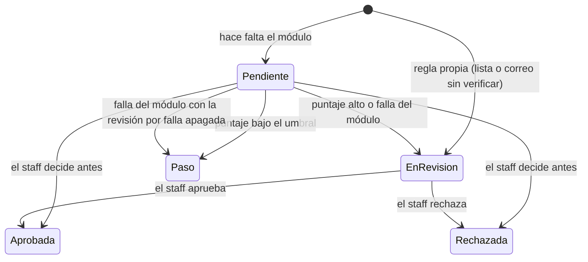

# Fraude y seguridad de acceso

**Estado:** v0, 2026-10-31 · **Parte de:** [diseño del núcleo](README.md) · **Decisiones:** D-08 y D-10

Este documento cubre lo que le faltaba al núcleo para cuidar los pedidos y los ingresos: la evaluación de fraude de
los pedidos con un módulo, la revisión manual, las listas de bloqueo, la verificación del correo, el historial de
ingresos con aviso de un lugar nuevo, los límites de intentos, la política de contraseñas y lo que faltaba del segundo
factor. Es diseño propio: sale de las decisiones D-08 y D-10, de la documentación pública de ASP.NET Core Identity, de
la guía NIST SP 800-63B para las contraseñas y de la documentación pública de MaxMind para el módulo de ejemplo. No se
usó nada de WHMCS.

---

## 1. Principios

- **Lo legal no se bloquea.** Los botones de baja y de arrepentimiento (Disposición 954/2025) no pasan por ninguna
  lista ni límite de este documento. Una IP bloqueada igual puede pedir la baja.
- **El fraude retiene, no borra.** Un pedido sospechoso queda en revisión: no se aprovisiona hasta que el staff lo
  aprueba. Rechazarlo lo cancela con su contracara, nunca borra nada (sección 13 del [modelo de dominio](dominio.md)).
- **Varios nodos.** Ajustes, listas, intentos, historial y revisiones están en PostgreSQL. Ningún límite que importe
  vive en la memoria de un nodo. El tope por IP en memoria de los formularios sigue como primera barrera, y el límite
  de esta sección es el que vale entre nodos.
- **Datos mínimos.** El módulo de fraude recibe solo lo que el manifiesto pide (sección 8 del
  [protocolo](protocolo-modulos-v0.md)). El historial de ingresos guarda IP, red y navegador, nunca la contraseña ni
  el correo que escribió alguien que no tiene usuario.
- **Ajustable desde el panel.** Todo lo que cambia según el proveedor se edita en el admin, queda en la auditoría y no
  pide reiniciar.

---

## 2. Ajustes

Una fila en `identity.security_settings`, con los ajustes en JSON y un número de versión para que dos personas del
staff no se pisen. Sin fila valen los de fábrica. Se lee en cada pedido que los necesita: es una lectura por clave.

| Grupo | Ajuste | Por defecto | Qué hace |
|---|---|---|---|
| Contraseñas | `MinLength` | 10 | Largo mínimo para clientes. Nunca menos de 8 |
| | `StaffMinLength` | 12 | Largo mínimo para el staff. Nunca menos que el de clientes |
| | `RequireUpper`, `RequireLower`, `RequireDigit`, `RequireSymbol` | No | Reglas de composición. NIST no las recomienda y vienen apagadas |
| | `RejectCommon` | Sí | Rechaza las contraseñas de la lista propia de comunes y las que contienen el correo o la marca |
| Intentos | `AccountAttempts`, `AccountMinutes` | 5 y 15 | Fallas seguidas de una cuenta que la bloquean, y por cuánto |
| | `StaffAccountAttempts`, `StaffAccountMinutes` | 5 y 15 | Lo mismo para las cuentas del staff, con su propio umbral |
| | `IpAttempts`, `IpWindowMinutes`, `IpMinutes` | 20, 15 y 30 | Fallas desde una IP dentro de la ventana que la bloquean, y por cuánto |
| | `TrustedNetworks` | Ninguna | IPs o redes que el límite por IP nunca bloquea, como la oficina o la VPN del staff. Hasta 50 |
| Segundo factor | `TwoFactorRoles` | Ninguno | Roles del portal que lo tienen obligatorio: `owner`, `billing` y `technical` |
| Correo | `RequireVerifiedEmail` | No | Un pedido de quien no verificó su correo va a revisión |
| Ingresos | `AlertNewLocation` | Sí | Aviso por correo de un ingreso desde una red nueva |
| | `KeepLoginDays` | 365 | Cuánto se guarda el historial de ingresos |
| Fraude | `FraudEnabled`, `FraudInstanceId` | No | Evaluar los pedidos con una instancia de un módulo de fraude |
| | `FraudReviewScore` | 50 | Desde qué puntaje, de 0 a 100, el pedido va a revisión |
| | `FraudReviewOnError` | Sí | Si el módulo falla del todo, el pedido va a revisión. Apagado, pasa |
| | `FraudSkipExisting` | No | Los pedidos de una cuenta que ya tiene un servicio activo o suspendido no van al módulo, que cobra cada consulta. Las reglas propias valen igual |

Para el staff el segundo factor es siempre obligatorio (D-10), y no es un ajuste.

---

## 3. Fraude

### 3.1 Tipo de módulo `fraud`

Un tipo nuevo del protocolo, con la operación `evaluate` (sección 9.6 del [protocolo](protocolo-modulos-v0.md)).
Recibe el pedido, la IP y lo que permita el manifiesto, y devuelve un puntaje de 0 a 100 (más alto es más riesgo),
los motivos y el ID de la evaluación en el servicio. Lleva clave de idempotencia (`order-{id}-evaluate`): cada
consulta a un servicio de puntaje cuesta, y un reintento no tiene que pagar dos veces.

El módulo de ejemplo es `minfraud`, para MaxMind minFraud (`src/modules/BillingOss.Module.MinFraud`). Se probó solo
contra un MaxMind falso. La prueba contra el servicio real está escrita y queda inconclusa sin sus variables.

### 3.2 Evaluación de un pedido (`FraudCheck`)

Una por pedido, en `orders.fraud_checks`. Se crea al confirmar el pedido, en la misma transacción, solo si el pedido
trae contexto de quien compra: los que hace el cliente en el portal (el actor es un cliente y se toma su IP) y los de
la API que mandan `client_ip`. Los que carga el staff o una integración sin IP no se evalúan.

En el código: `Pending`, `Passed`, `Review`, `Approved` y `Rejected`. Si no hay ninguna regla que se cumpla ni módulo
configurado, no se crea la evaluación y el pedido sigue como siempre.

**Reglas propias**, que corren al confirmar y sin red: la IP, el correo o el dominio del correo de la cuenta están en
una lista de bloqueo (sección 4), o el ajuste `RequireVerifiedEmail` está prendido y quien compra no verificó su
correo. Cualquiera manda el pedido a revisión con su motivo, sin consultar al módulo. Con `FraudSkipExisting`, el
pedido de una cuenta que ya tiene un servicio activo o suspendido no va al módulo, pero las reglas propias corren igual.

**Retención.** Mientras la evaluación está pendiente o en revisión, el pedido está retenido: ningún servicio suyo
pasa de pendiente a aprovisionando, aunque la factura se pague. La traba está en el único lugar donde eso pasa
(`BillingCore.StartProvisioning`) y lee la evaluación con el pedido bloqueado. La liberación (aprobada o aceptada)
toma el mismo lock y aprovisiona con la regla del pedido según el alta de cada producto: el de alta al pedir sale aunque
no esté pago, el que acepta el staff espera la aceptación del pedido y el resto sale si ya estaba pago o era de total
cero. Así un pago que llega durante la evaluación nunca deja un servicio sin aprovisionar ni aprovisiona uno retenido.
Con el lock tomado, la traba vuelve a leer el estado del servicio en la base: quien lo leyó antes de un rechazo lo tiene
pendiente en memoria, y sin esa lectura lo aprovisionaría. Un pedido rechazado nunca aprovisiona nada. `AcceptOrder` de
la API compatible y la aceptación manual rechazan un pedido retenido: se decide en la revisión.

**Rechazo.** El pedido pasa a cancelado y sus servicios pendientes también. Cada factura del pedido que no tiene nada
pagado se anula con una nota de crédito. Una que tiene algo pagado queda como está y la revisión lo avisa: el staff
decide si devuelve el pago (reembolso, sección 12.4 del modelo) o lo deja a favor. No se pasa solo a saldo a favor
porque esa plata puede ser de una tarjeta robada y serviría para otro pedido.

**Varias facturas.** Un pedido que mezcla modos de carga sale en una factura por modo, y el pedido guarda solo la
primera. Por eso la liberación mira servicio por servicio: aprovisiona el que tiene sus facturas pagas, y el resto
espera su pago como siempre. Las facturas del pedido son las que tienen renglones de sus servicios, y de ahí salen el
total que recibe el módulo y los importes de la pantalla de revisión.

### 3.3 Trabajo `fraud.screen`

Clave de entidad `order:{id}` y de deduplicación `fraud.screen:{id}`, hasta 5 intentos. Llama al módulo fuera de
toda transacción y decide con el pedido bloqueado. Un error reintentable vuelve a la cola. Un error definitivo, o el
último intento, aplica `FraudReviewOnError`. Si el staff ya decidió mientras tanto, el resultado se guarda y no cambia
la decisión. La respuesta del módulo se valida: puntaje decimal entre 0 y 100, hasta 20 motivos con código de 64
caracteres y texto de 300.

---

## 4. Listas de bloqueo

`identity.blocked_entries`: IP o red (`cidr`), correo o dominio, con motivo, origen (staff, API o automático), quién
la cargó y vencimiento opcional. Un valor está una sola vez por tipo. Las vencidas no cuentan y la retención las
borra a los 30 días.

| Lista | Dónde se mira |
|---|---|
| IP o red | Ingreso del portal y del admin (también el paso del código y la ida y la vuelta de un proveedor externo), registro y pedidos (van a revisión) |
| Correo | Pedidos (a revisión), recuperar la contraseña (no se manda nada) y el registro y el alta con un proveedor ([ingreso de clientes](ingreso-clientes.md)) |
| Dominio | Lo mismo que el correo, con el dominio del correo |

El bloqueo automático por intentos (sección 6) es una entrada de IP con vencimiento y origen automático: el staff la
ve y la puede sacar. Nunca acorta una entrada permanente que cargó el staff.

Como la lista de IP también frena el ingreso al admin, la pantalla de bloqueos no deja cargar una red que incluye la
IP de quien la está cargando. La API sí, porque la usan integraciones.

---

## 5. Correo verificado

`PortalUser.EmailConfirmed`, que ya existía. El cliente pide el enlace desde su página de seguridad y le llega por
correo (plantilla `email-verification`). El enlace usa un proveedor de tokens de Identity propio, con Data Protection
(cuyo anillo de llaves está en la base) y 24 horas de vida, y queda atado al sello del usuario: cambiar la contraseña
lo invalida. Se confirma sin iniciar sesión. Restablecer la contraseña también confirma, porque el enlace llegó al
correo.

---

## 6. Ingresos, intentos y avisos

### 6.1 Historial (`identity.login_events`)

Cada intento de ingreso al portal o al admin: a quién (si existe), IP, red, navegador (300 caracteres), resultado,
método e instante.

| Resultado | Cuándo |
|---|---|
| `Success` | Ingresó, con contraseña sola o con el segundo factor |
| `BadPassword` | Contraseña incorrecta de un usuario que existe |
| `UnknownUser` | Correo sin usuario. No se guarda el correo |
| `Locked` | La cuenta estaba bloqueada por intentos |
| `BlockedIp` | La IP está en la lista o bloqueada por intentos |
| `BadCode` | Código del segundo factor o de recuperación incorrecto |
| `Disabled` | Usuario deshabilitado |

Métodos: `Password`, `Totp`, `RecoveryCode` y `External` (Google u otro proveedor, [ingreso de clientes](ingreso-clientes.md)). El ingreso del staff por OIDC queda con el método del TOTP que le sigue,
igual que la contraseña cuando hay segundo factor: lo que se anota es el paso que termina el ingreso.

### 6.2 Límites de intentos

- **Por cuenta:** `AccountAttempts` fallas seguidas (contraseña o código) la bloquean `AccountMinutes`. Va en la
  fila del usuario, como antes, pero con los ajustes del panel. El staff tiene su propio umbral
  (`StaffAccountAttempts` y `StaffAccountMinutes`). El bloqueo no corta sesiones abiertas.
- **Por IP:** si una IP junta `IpAttempts` fallas en `IpWindowMinutes`, queda bloqueada `IpMinutes` con una entrada
  automática en la lista. Se cuenta en el historial, así vale entre nodos. En IPv6 se cuenta y se bloquea la red
  `/64`, que es lo mínimo que recibe cualquier conexión: contando por dirección, cambiar de dirección alcanzaría para
  no llegar nunca al tope. Las redes de `TrustedNetworks` nunca se bloquean por intentos, aunque sus fallas quedan en
  el historial.

### 6.3 Aviso de un lugar nuevo

Un ingreso exitoso desde una red (`/24` en IPv4 y `/48` en IPv6) desde la que ese usuario nunca había entrado manda
un aviso por correo (plantilla `new-login`) con la fecha, la IP y el navegador, y queda marcado en el historial. El
primer ingreso de un usuario no avisa. Sin base de geolocalización, la red es el lugar.

---

## 7. Contraseñas

Un validador de Identity propio que lee los ajustes. Vale al crear el usuario, al restablecer y al cambiar la
contraseña. Siguiendo NIST SP 800-63B: largo mínimo, hasta 128 caracteres, sin vencimiento periódico, y rechazo de
las comunes y de las que contienen el correo o el nombre de la marca. La lista de comunes es propia y chica, escrita a
mano. El cliente y el staff pueden cambiar la suya con la sesión iniciada, con la contraseña actual. Cambiarla
renueva el sello y corta las demás sesiones. La contraseña inicial que genera `staff add` cumple la política del
momento: el largo del staff (nunca menos de 20) y un carácter de cada clase, por si la composición está prendida.

---

## 8. Segundo factor

Ya existían el TOTP, los 8 códigos de recuperación y el obligatorio del staff. Se suma:

- **QR para enrolar:** la página que enrola el TOTP muestra el QR del enlace `otpauth`, armado en el servidor con el
  generador de QR del PDF fiscal. La clave no sale a ningún servicio de afuera y la clave en texto sigue al lado.
- **Códigos de recuperación:** la página de seguridad dice cuántos quedan y avisa con 2 o menos. Se generan otros 8
  con un código TOTP vigente, y los anteriores dejan de valer. Un ingreso con código de recuperación queda en el
  historial con su método.
- **Obligatorio por rol:** con `TwoFactorRoles`, un cliente que tiene alguno de esos roles en alguna cuenta (titular,
  facturación o técnico) no ve otra página del portal que la de seguridad hasta enrolarlo. También se le pide al que
  lo tenía en el sistema anterior (`TwoFactorRequired`). Es un requisito de la política de autorización del portal
  (`TwoFactorEnrolled`), así vale para toda página o ruta que use su sesión, también las que no son páginas como el
  PDF de una factura y las que se agreguen después. Las únicas excepciones son la página de seguridad y la salida.
- **Quitarlo:** el staff con `security.manage` le puede quitar el segundo factor a un cliente que perdió el teléfono
  y los códigos, desde su ficha (`security.2fa_reset`). Para el staff, el comando `staff reset-2fa <correo>`
  (`staff.2fa_reset`, con el comando como actor). Queda en la auditoría y corta sus sesiones.
- **Exigirlo a un cliente:** el staff con `security.manage` le exige el segundo factor a un usuario de la cuenta, o
  se lo deja de exigir, desde la seguridad de la ficha (`security.2fa_required`). Usa la misma marca que trae el
  sistema anterior (`TwoFactorRequired`), así el portal lo trata igual que a un rol obligatorio. No corta sus
  sesiones: en el próximo pedido va a la página de seguridad.
- **OIDC del staff:** la seguridad propia del staff dice si el ingreso por el proveedor está configurado en ese nodo
  y si su usuario está vinculado. Es de solo lectura: se configura con `Staff:Oidc` y se vincula con `staff oidc`.

---

## 9. Permisos

| Permiso del staff | Qué deja |
|---|---|
| `security.read` | Ver el historial de ingresos de todos y la seguridad de las fichas |
| `security.manage` | Editar los ajustes y las listas, quitarle el segundo factor a un cliente o exigírselo |
| `orders.review` | Ver la cola de revisión y aprobar o rechazar pedidos |

Permisos de la API: `orders:review` (cola y decisión), `security:read` (listas) y `security:write` (cargar y sacar
entradas de las listas).

---

## 10. API

| Método y ruta | Permiso | Qué hace |
|---|---|---|
| `GET /api/v1/orders/review` | `orders:review` | Pedidos retenidos, con puntaje y motivos |
| `POST /api/v1/orders/{id}/review` | `orders:review` | `{"decision": "approve" o "reject", "note": "..."}`. Devuelve el estado, las notas de crédito (`credit_note_ids`) y lo pagado que quedó |
| `GET /api/v1/security/blocklist` | `security:read` | Entradas vigentes |
| `POST /api/v1/security/blocklist` | `security:write` | `{"kind": "ip", "value": "203.0.113.0/24", "reason": "...", "expires_at": null}` |
| `DELETE /api/v1/security/blocklist/{id}` | `security:write` | Saca una entrada |

`POST /api/v1/orders` suma `client_ip`: con ella el pedido se evalúa como uno del portal.

---

## 11. Pantallas

| Ruta | Quién | Qué hace |
|---|---|---|
| `/cuenta/seguridad` | Cliente | Correo verificado, cambio de contraseña, segundo factor con los códigos que quedan y los nuevos, y últimos ingresos |
| `/cuenta/verificar` | Cualquiera | Confirma el correo con el enlace |
| `/admin/seguridad` | Staff | Su contraseña, sus códigos de recuperación y sus ingresos |
| `/admin/seguridad/ajustes` | `security.manage` | Los ajustes de la sección 2 |
| `/admin/seguridad/bloqueos` | `security.manage` | Las listas de bloqueo |
| `/admin/seguridad/ingresos` | `security.read` | El historial de todos, con filtros |
| `/admin/pedidos/revision` | `orders.review` | La cola de pedidos retenidos, con puntaje y motivos, y la decisión |
| `/admin/cuentas/{id}/seguridad` | `accounts.read` | La seguridad de los usuarios de la cuenta y las evaluaciones de sus pedidos, con el enlace desde la ficha. Los ingresos piden además `security.read`, y quitar el segundo factor, `security.manage` |

En el menú del admin de la sección 10.2 de la decisión de interfaz (D-19), cada pantalla cuelga así:

| Área del menú | Ítem | Pantalla |
|---|---|---|
| Pedidos | Revisión de fraude | `/admin/pedidos/revision`, con la cantidad de retenidos al lado y en la línea de pendientes |
| Clientes | La ficha del cliente, solapa de seguridad | `/admin/cuentas/{id}/seguridad` |
| Utilidades | Registro de ingresos | `/admin/seguridad/ingresos` |
| Configuración | Seguridad y fraude | `/admin/seguridad/ajustes` y `/admin/seguridad/bloqueos` |
| Junto al nombre del staff | Mi seguridad | `/admin/seguridad` |

En el portal, la página de seguridad va en Cuenta, como dice la sección 10.3. Mientras el menú de 10.2 no está
construido, la barra del admin muestra la revisión (solo con `orders.review`, con la cantidad de retenidos) y la
seguridad propia, que enlaza al resto según los permisos.

---

## 12. Fuera de v0

- Informarle al servicio de puntaje un fraude confirmado o un contracargo (`fraud.report`).
- Geolocalización de la IP para el aviso de lugar nuevo y para mostrar el país. Con ella entrarían las reglas por
  país (de riesgo, o distinto del de la factura). Mientras tanto las cubre el puntaje del módulo.
- Consultar contraseñas filtradas en un servicio externo (k-anonimato).
- Volver a evaluar un pedido después de que cambie algo.
- Aceptar cada código TOTP una sola vez dentro de su ventana, como pide NIST SP 800-63B. Hoy, igual que el proveedor
  de fábrica de Identity, un código vale mientras dura su ventana: hace falta guardar el último paso usado por usuario.
- Un captcha en los formularios de trámites. El desafío anti robots opcional del ingreso, la recuperación, el registro,
  el contacto y el ticket sin cuenta, con una prueba de trabajo propia o Turnstile, está en
  [ingreso de clientes](ingreso-clientes.md). Los botones de baja y de arrepentimiento nunca lo piden.
- Las preguntas de seguridad no se hacen: NIST SP 800-63B no las admite como factor.
- Mandar a revisión los pedidos con correo de un proveedor gratuito. La lista de dominios no sirve para eso, porque
  además frena la recuperación de la contraseña de esas casillas.
